# Backend & Cloud Engineering on Google Cloud (GCP) and AWS
### A study book for engineers who want senior-level backend and cloud skills

---

## Who this is for

**This book is for you if you are:**
- a **software engineer** (frontend, full-stack, mobile or backend) moving deeper into backend and cloud work;
- a **mid-level backend engineer** who wants the depth and judgment expected of a senior;
- an engineer who knows **one cloud** and needs to work confidently on **both Google Cloud and AWS**.

**You already know:** HTTP and REST, JavaScript and TypeScript deeply, async/await, Node basics,
testing, Git, Docker basics, and how to ship product. This book does **not** re-teach any of that.

**You will learn** what changes when you own the **server, the data and the infrastructure**:
production Node, API design beyond CRUD, identity and authorization, PostgreSQL internals,
concurrency, distributed systems, testing, observability, security engineering, cloud IAM,
compute and networking, infrastructure as code, reliability and system design.

**This is not for** complete beginners to programming or HTTP, or people looking for a
click-by-click console tutorial.

## How the clouds are covered

Every principle in this book is cloud-neutral. Whenever a chapter uses a cloud service, it shows
the **Google Cloud and AWS equivalents side by side** in a **☁️ GCP ↔ AWS** table, including the
differences that actually trip people up when moving between them. Azure equivalents are listed in
[Appendix C](#appendix-c--gcp--aws-map-plus-azure).

### How each chapter works

| Section | Purpose |
|---|---|
| 🎯 **Outcomes** | What you should be able to do afterwards |
| 🔁 **Intuition check** | The common assumption, and where it breaks |
| 📖 **Core ideas** | The concepts, at depth |
| 🗺️ **Picture it** | A diagram of the idea |
| 🔍 **Worked example** | A realistic scenario, step by step |
| ✅ **Best practices** | What strong engineers do — and avoid |
| ⚠️ **Pitfalls** | The bugs and outages these ideas prevent |
| 🧠 **Check yourself** | Interview-level questions; answers hidden |
| 🛠️ **Lab** | Hands-on work that cements the chapter |
| 📌 **Remember** | The chapter in a few lines |

**Deep dives.** Key terms have their own pages with more detail, code and sources — see the
[concept deep dives](concepts/README.md) and the [SQL guides](sql/README.md), or the **🔗 Go deeper**
box at the end of each chapter.

**Running example — TaskFlow:** a multi-tenant team task tracker (orgs, teams, tasks, comments,
attachments, notifications, dashboards). Every chapter's examples come from it.

---

## Contents

**Part I — Services**
1. [Production Node.js](#chapter-1--production-nodejs)
2. [API design beyond CRUD](#chapter-2--api-design-beyond-crud)
3. [Identity, authentication and authorization](#chapter-3--identity-authentication-and-authorization)
4. [Architecture that stays changeable](#chapter-4--architecture-that-stays-changeable)

**Part II — Data**
5. [PostgreSQL internals that matter](#chapter-5--postgresql-internals-that-matter)
6. [Query performance and indexing](#chapter-6--query-performance-and-indexing)
7. [Transactions, isolation and locking](#chapter-7--transactions-isolation-and-locking)
8. [Schema evolution and data modelling](#chapter-8--schema-evolution-and-data-modelling)
9. [Caching and data beyond Postgres](#chapter-9--caching-and-data-beyond-postgres)

**Part III — Distributed systems**
10. [Messaging, events and async workflows](#chapter-10--messaging-events-and-async-workflows)
11. [Failure, resilience and consistency](#chapter-11--failure-resilience-and-consistency)

**Part IV — Operating software**
12. [Testing backends properly](#chapter-12--testing-backends-properly)
13. [Observability and SLOs](#chapter-13--observability-and-slos)
14. [Security engineering](#chapter-14--security-engineering)

**Part V — Cloud**
15. [Cloud identity and IAM in depth](#chapter-15--cloud-identity-and-iam-in-depth)
16. [Compute, containers and networking](#chapter-16--compute-containers-and-networking)
17. [Infrastructure as Code and delivery](#chapter-17--infrastructure-as-code-and-delivery)

**Part VI — Senior practice**
18. [System design](#chapter-18--system-design)
19. [Technical leadership](#chapter-19--technical-leadership)

**Appendices**
- [A · Principles at a glance](#appendix-a--principles-at-a-glance)
- [B · 12-week study plan](#appendix-b--12-week-study-plan)
- [C · GCP ↔ AWS map (plus Azure)](#appendix-c--gcp--aws-map-plus-azure)
- [D · Numbers and formulas worth knowing](#appendix-d--numbers-and-formulas-worth-knowing)
- [E · Further reading](#appendix-e--further-reading)
- [F · Deep dives: concepts and SQL](#appendix-f--deep-dives-concepts-and-sql)

---

# Part I — Services

---

## Chapter 1 · Production Node.js

### 🎯 Outcomes
- Explain what blocks a Node server and how to detect it in production
- Use the libuv threadpool, worker threads and streams deliberately
- Run Node correctly behind a load balancer: pooling, keep-alive, shutdown, request context

### 🔁 Intuition check
A slow function feels like a local problem. On a server, a long synchronous task stalls **every
request on that instance**, and a small memory leak accumulates for weeks because the process never
restarts on its own.

### 📖 Core ideas

**The event loop, in production terms.** JavaScript runs on one thread per process. Each loop
iteration processes timers, I/O callbacks, `setImmediate` and close handlers, with microtasks
(promise callbacks) drained between steps. What matters operationally:
- **Event loop lag** is the key health metric. If p99 lag climbs above a few tens of milliseconds,
  something synchronous is hogging the thread: `JSON.parse` of a 20 MB body, a regex with
  catastrophic backtracking, a big sort, synchronous crypto or `fs.*Sync`.
- Measure it with `perf_hooks.monitorEventLoopDelay()` and export it as a metric.

**The libuv threadpool.** Some "async" APIs aren't truly async in the kernel; libuv runs them on a
small threadpool (**4 threads by default**, `UV_THREADPOOL_SIZE`): file system calls,
`dns.lookup`, `crypto.pbkdf2/scrypt`, `zlib`. Four concurrent bcrypt hashes can starve your file
reads and DNS lookups. Network I/O does *not* use the pool.

**CPU-bound work.** Options, in order of preference:
1. Push it to the database (aggregations, filtering) — Postgres is very good at it.
2. Move it off the request path to a queue and worker (Chapter 10).
3. Use `worker_threads` for genuinely parallel CPU work inside a process.

**Streams and backpressure.** Never buffer whole files or exports in memory. Use streams with
`pipeline()` so a slow consumer slows the producer instead of growing the heap:
```ts
import { pipeline } from 'node:stream/promises'
await pipeline(db.queryStream(sql), toCsv(), createGzip(), res)
```

**Connections are a resource.**
- Use a **database connection pool**, sized deliberately: `instances × pool size` must stay under
  the database's connection limit (Chapter 6).
- Reuse outbound HTTP connections (keep-alive; `undici`/`fetch` agents) — new TLS handshakes per
  request add latency and CPU.
- Set **timeouts on every outbound call**. The default for many clients is "wait forever".

**Request context.** Use `AsyncLocalStorage` to carry a request id, user and trace context through
async calls without threading parameters everywhere — then every log line can include them.

**Process lifecycle.**
- **Graceful shutdown:** on `SIGTERM`, stop accepting connections, let in-flight requests finish
  (bounded by a deadline), drain workers, close pools, exit. Platforms send `SIGTERM` on every
  deploy and scale-in.
- **Crash on unknown state:** on `uncaughtException`, log and exit; the platform restarts you.
  Continuing after an unknown exception risks corrupted state. Treat `unhandledRejection` the same.
- **Memory:** watch heap usage and GC pauses; set `--max-old-space-size` to fit the container's
  memory limit, or the kernel OOM-kills you before V8 can collect.

### 🗺️ Picture it

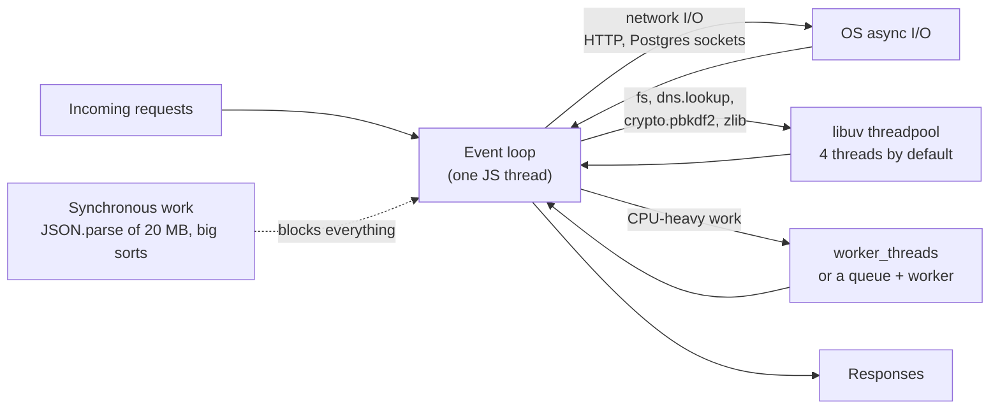

### 🔍 Worked example
TaskFlow's p99 latency jumps from 80 ms to 2 s, but CPU is only 40% and the database is idle.
Event loop lag shows 1.8 s spikes. A heap snapshot and CPU profile point to an export endpoint
that `JSON.stringify`s 200k tasks synchronously. Fix: stream rows from a cursor through a CSV
transform with `pipeline()`, and move very large exports to a background job that writes to
object storage and emails a signed link. p99 returns to 85 ms.

### ✅ Best practices
- ✅ Alert on event loop lag, heap usage and restart count, not just CPU.
- ✅ Stream large payloads; respect backpressure.
- ✅ Size pools against database limits; reuse outbound connections.
- ✅ Timeouts on every network call; `AbortSignal` to cancel work.
- ✅ `AsyncLocalStorage` for request context; graceful shutdown with a deadline.
- ❌ Don't do CPU-heavy or synchronous work on the request path.
- ❌ Don't keep running after an uncaught exception.

### ⚠️ Pitfalls
- bcrypt/scrypt saturating the 4-thread libuv pool and slowing unrelated file and DNS work.
- A container memory limit lower than V8's heap ceiling → silent OOM kills.
- Unbounded `Promise.all` over 10,000 items → thousands of simultaneous DB queries; use a concurrency limit.

### 🧠 Check yourself
1. Which of these use the libuv threadpool: `fs.readFile`, an HTTP request, `crypto.pbkdf2`, `dns.lookup`, a Postgres query over TCP?
2. CPU is low but latency is terrible. What do you check first, and why?
3. Why is "log and keep running" on `uncaughtException` dangerous?

<details><summary>Answers</summary>

1. `fs.readFile`, `crypto.pbkdf2` and `dns.lookup`. Network sockets (HTTP, Postgres over TCP) don't.
2. Event loop lag and outbound waits (pool exhaustion, missing timeouts). Low CPU with high latency usually means the loop is blocked in bursts, or requests are queued waiting for a connection or a slow dependency.
3. The process may be in an inconsistent state (half-applied changes, leaked locks or connections); restarting is the only safe recovery.
</details>

### 🛠️ Lab
Add event-loop-delay and heap metrics to a service. Write an endpoint that blocks for 500 ms and
load-test it alongside a fast endpoint; watch the fast one's p99. Then fix it with a worker thread.

### 🔗 Go deeper
[Event loop and libuv threadpool](concepts/event-loop-and-libuv.md) · [Streams and backpressure](concepts/streams-and-backpressure.md) · [Connection pooling](concepts/connection-pooling.md) · [Little's Law](concepts/littles-law.md)

### 📌 Remember
- Event loop lag is the health metric; the threadpool has 4 threads.
- Stream, pool, reuse, time out.
- Graceful shutdown; crash on unknown state.

---

## Chapter 2 · API design beyond CRUD

### 🎯 Outcomes
- Design idempotent, concurrency-safe and evolvable APIs
- Choose pagination, versioning and error models deliberately
- Use HTTP features (conditional requests, caching headers) that most APIs ignore

### 🔁 Intuition check
It's easy to think of an API as a set of endpoints. Clients see it as a promise: once they depend
on an error code, a field or a pagination style, changing it breaks them — and you have to keep
every client working for years.

### 📖 Core ideas

**Contract-first.** Define the contract (OpenAPI or a field-level spec) before code, review it
with consumers, and test that implementation and docs agree. Treat the contract as a published
interface with a compatibility promise.

**Idempotency for unsafe operations.** Clients retry on timeouts, and a timeout doesn't tell them
whether the server committed. For `POST`s with side effects:
- Accept an `Idempotency-Key` header.
- Store `(key, caller, request hash) → response` atomically with the side effect.
- On a repeat with the same key and body, return the stored response; with a different body, return `422`/`409`.
- Expire keys after a sensible window (e.g. 24 hours).

**Optimistic concurrency over HTTP.** Return an `ETag` (a version) with resources. Clients send
`If-Match: "<etag>"` on updates; if the resource changed meanwhile, respond **`412 Precondition
Failed`**. This prevents lost updates between users without locks.

**Conditional reads.** `ETag` + `If-None-Match` → `304 Not Modified` saves bandwidth on polling
endpoints. Set `Cache-Control` correctly (`private, no-store` for per-user data; `public, max-age`
only for genuinely shared data).

**Pagination.**
- Prefer **keyset (cursor) pagination**: `WHERE (created_at, id) < ($1, $2) ORDER BY created_at DESC, id DESC LIMIT 51`.
  Always include a **unique tie-breaker** (the id), or rows with equal timestamps are skipped or duplicated.
- Encode the cursor opaquely (base64 JSON) so you can change it later.
- Offer `totalCount` only where it's cheap; `count(*)` on big filtered sets is expensive.

**Errors.** One envelope, stable machine codes, correct statuses, and `details` for structured
context. Consider RFC 9457 (Problem Details) if you want a standard. Distinguish *retryable*
(`429`, `503` with `Retry-After`) from *non-retryable* errors so clients can behave.

**Scope by identity.** `/me/...` endpoints derive the subject from the authenticated caller — a
whole class of authorization bugs disappears.

**Evolution.**
- Additive changes are safe *if clients ignore unknown fields* — say so in your contract.
- Breaking changes: new version, or the **deprecate → migrate → remove** cycle with a
  `Deprecation`/`Sunset` header, usage metrics on the old path, and a removal date.
- Never change the *meaning* of a field silently (units, percent vs fraction, time zone).

**Bulk and long-running operations.** For work over a few seconds, return `202 Accepted` with a
status resource (`/jobs/{id}`) instead of holding the connection. For bulk changes, decide
explicitly between all-or-nothing and per-item results.

**Beyond REST.** GraphQL fits many heterogeneous clients but moves complexity to the server (N+1
via resolvers — use dataloaders; per-field authorization; query cost limits). gRPC fits
service-to-service traffic with strict contracts. Events/webhooks fit integrations — sign them,
retry them, and make receivers idempotent.

### 🗺️ Picture it

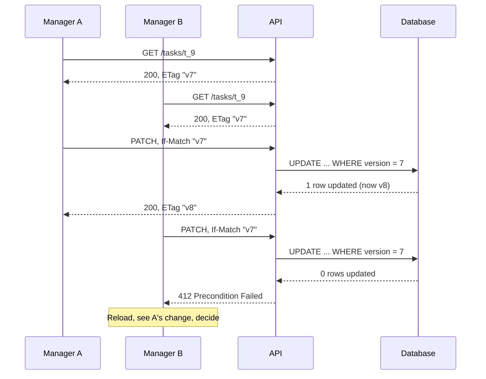

### 🔍 Worked example
Two managers edit the same task's assignee at once. Without concurrency control, the second
silently overwrites the first. With ETags:
1. Both `GET /v1/tasks/t_9` → `ETag: "v7"`.
2. Manager A `PATCH` with `If-Match: "v7"` → succeeds, task becomes `v8`.
3. Manager B `PATCH` with `If-Match: "v7"` → `412`. The UI reloads, shows A's change, and lets B decide.
Server side: `UPDATE tasks SET … , version = version + 1 WHERE id = $1 AND version = $2` — zero rows updated means `412`.

### ✅ Best practices
- ✅ Contract-first, with a test that docs and routes agree.
- ✅ Idempotency keys on side-effecting `POST`s.
- ✅ ETag/`If-Match` for concurrent edits; `304` for polling.
- ✅ Keyset pagination with a unique tie-breaker; opaque cursors.
- ✅ Mark errors retryable or not; send `Retry-After`.
- ✅ Deprecate with headers, metrics and dates.
- ❌ Don't change field semantics in place.
- ❌ Don't hold connections open for long jobs.

### ⚠️ Pitfalls
- Offset pagination on a feed that changes → duplicated or missing items.
- Idempotency stored *after* the side effect commits → duplicates on crash between the two.
- Caching per-user responses at a shared layer.

### 🧠 Check yourself
1. Why must the idempotency record be written in the same transaction as the side effect?
2. What's wrong with `ORDER BY created_at LIMIT 50` + `WHERE created_at < $cursor`?
3. When would you return `412`, and when `409`?

<details><summary>Answers</summary>

1. Otherwise a crash between them either loses the record (duplicate on retry) or records a response for work that never happened.
2. No tie-breaker: rows sharing a timestamp at the page boundary are skipped or repeated. Use `(created_at, id)`.
3. `412` when a client precondition (`If-Match`) fails; `409` when the request conflicts with current state for other reasons (e.g. a uniqueness clash).
</details>

### 🛠️ Lab
Add ETag/`If-Match` to an update endpoint and idempotency keys to a create endpoint, with tests
that fire concurrent and duplicate requests.

### 🔗 Go deeper
[Idempotency](concepts/idempotency.md) · [Optimistic concurrency and ETags](concepts/optimistic-concurrency-etags.md) · [Keyset pagination](concepts/keyset-pagination.md)

### 📌 Remember
- Contract-first; scope by identity.
- Idempotency keys, ETags, keyset pagination with tie-breakers.
- Evolve additively; deprecate visibly.

---

## Chapter 3 · Identity, authentication and authorization

### 🎯 Outcomes
- Design authentication for users and for services, including token lifecycle
- Choose and implement an authorization model that scales with the product
- Prevent broken access control systematically, not case by case

### 🔁 Intuition check
Login is often treated as the hard part. The harder part is what happens after it: **verifying**
every token, **deciding** permissions on every object, and handling leaked tokens and changed roles.

### 📖 Core ideas

**User authentication.** Delegate it to an identity provider (IdP). Your backend:
- Verifies tokens: signature against the IdP's **JWKS** (cache keys, honour `kid`, handle rotation),
  `iss`, `aud`, `exp`/`nbf`, and expected algorithm (reject `alg: none` and algorithm confusion).
- Keeps access tokens **short-lived**; refresh tokens are rotated and revocable.
- For browser apps, prefer a **BFF** that keeps tokens server-side in `HttpOnly` cookies over
  storing tokens in JavaScript-accessible storage. Public clients use **PKCE**.

**Service-to-service authentication.** Prefer platform-issued identities over shared secrets:
cloud workload identity (signed ID tokens audienced to the target service), mTLS in a service mesh,
or OAuth client credentials. A pattern worth knowing: an edge proxy authenticates the user, the
frontend server calls the backend with **its own** signed identity token plus the end-user
identity in a header, and the backend trusts that header **only after verifying the caller is an
allow-listed service**.

**Authorization models.**
- **RBAC** — roles to permissions. Simple; breaks down with per-resource rules.
- **ABAC** — policies over attributes of subject, resource and context.
- **ReBAC** — permissions derived from relationships (Google Zanzibar; OpenFGA, SpiceDB). Fits sharing, hierarchies and multi-tenancy.
- Most products end up as **RBAC within a tenant + relationship checks per object**.

**Make authorization structural.**
- Centralize checks in the service layer behind one function per decision
  (`canEditTask(actor, task)`), not scattered `if` statements.
- **Tenant isolation:** every query on tenant data is filtered by tenant — enforce it in the
  repository layer or with Postgres **row-level security** so a forgotten `WHERE` can't leak data.
- Prefer **404 over 403** where existence is sensitive.
- **Deny by default**; test authorization for every route (no identity, wrong role, other tenant,
  other user's object).

**Revocation and change.** Short token lifetimes bound exposure; for immediate effect (user
removed from a team), authorization must read current state from the database rather than trust
roles baked into a long-lived token.

### 🗺️ Picture it

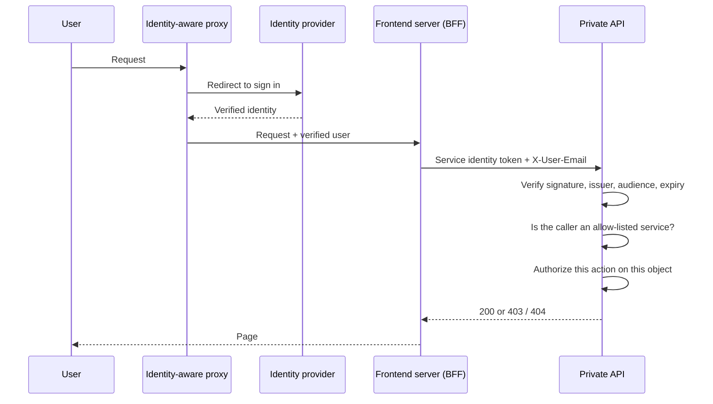

### 🔍 Worked example
TaskFlow is multi-tenant. A bug in a new "search tasks" endpoint forgets `WHERE org_id = $1`.
With row-level security:
```sql
ALTER TABLE tasks ENABLE ROW LEVEL SECURITY;
CREATE POLICY tenant_isolation ON tasks USING (org_id = current_setting('app.org_id')::uuid);
```
The service sets `SET LOCAL app.org_id = '<caller org>'` inside each transaction. The buggy query
now returns only the caller's org — the database enforces isolation even when application code
forgets.

### ✅ Best practices
- ✅ Delegate login to an IdP; verify JWTs fully, with JWKS rotation.
- ✅ Short-lived access tokens; rotated refresh tokens; BFF cookies for browsers.
- ✅ Workload identity for services; trust forwarded identity only from verified callers.
- ✅ Centralized, testable authorization decisions; tenant isolation enforced in data access.
- ✅ Authorization tests for every route and every error code.
- ❌ Don't trust ids, roles or tenant ids from the request body.
- ❌ Don't put long-lived permissions in tokens if they must be revocable quickly.

### ⚠️ Pitfalls
- Accepting tokens without checking `aud` → a token for another service works on yours.
- JWKS fetched on every request (slow) or never refreshed (breaks on key rotation).
- Authorization only in routes, bypassed by a second route calling the same service.

### 🧠 Check yourself
1. A JWT validates against your JWKS but `aud` is another service. Accept it?
2. Why is RBAC alone usually insufficient for a collaboration product?
3. How does row-level security change the failure mode of a missing tenant filter?

<details><summary>Answers</summary>

1. No. Audience restriction is what stops tokens minted for one service being replayed against another.
2. Permissions depend on the specific object (shared with me, my team's project), not just a global role; that needs ABAC/ReBAC-style checks.
3. Instead of leaking other tenants' rows, the query returns only rows the policy allows — the bug becomes a functional bug rather than a data breach.
</details>

### 🛠️ Lab
Implement tenant isolation with Postgres RLS and a per-transaction setting, then write a test that
deliberately omits the tenant filter and proves no cross-tenant rows are returned.

### 🔗 Go deeper
[JWTs and token verification](concepts/jwt-and-token-verification.md) · [Authorization models](concepts/authorization-models.md) · [Row-level security](concepts/row-level-security.md) · [Workload identity](concepts/workload-identity-federation.md)

### 📌 Remember
- Verify tokens fully; keep them short-lived.
- Workload identity between services.
- Centralize authorization; enforce tenant isolation in the data layer.

---

## Chapter 4 · Architecture that stays changeable

### 🎯 Outcomes
- Structure a service so rules are testable and storage is swappable
- Decide between a modular monolith and services with real criteria
- Enforce boundaries automatically

### 🔁 Intuition check
Most codebases start clean and tangle as features pile up. Backend code lives for years and carries
data invariants, so tangled business rules become expensive bugs, not just messy code.

### 📖 Core ideas

**Layers with one-way dependencies**
```
transport (HTTP/gRPC/queue handlers) → application services → domain → ports (interfaces) ← adapters (Postgres, HTTP clients, queues)
```
- **Transport:** parse, validate shape, authenticate, call one use case, map the result.
- **Application services:** use cases — authorization, orchestration, transactions.
- **Domain:** pure business rules, no I/O, unit-testable.
- **Ports/adapters:** interfaces owned by the core, implemented at the edges.

**Composition root.** Wire concrete adapters into services in one place at startup (plain
constructor injection is enough). Tests wire fakes or real test databases instead.

**Transactions belong to use cases.** A *unit of work* abstraction lets a service run several
repository calls in one transaction without knowing about the database driver.

**Modules by business capability**, each owning its data and exposing a small interface to other
modules. Other modules never reach into its tables directly.

**Modular monolith vs services.** Start modular-monolith. Split a module into a service when you
have a concrete driver: independent scaling, a different deploy cadence owned by another team,
fault isolation, or regulatory boundaries. Splitting costs network failure modes, distributed
transactions, versioned contracts and operational overhead.

**Enforce boundaries in CI** — dependency rules (lint rules, `dependency-cruiser`, architecture
tests): "services may not import the ORM", "module A may not import module B's internals".

**Single source of truth for rules.** If two endpoints compute the same metric, they call the same
function or SQL fragment. Duplicated rules drift and two screens disagree.

### 🗺️ Picture it

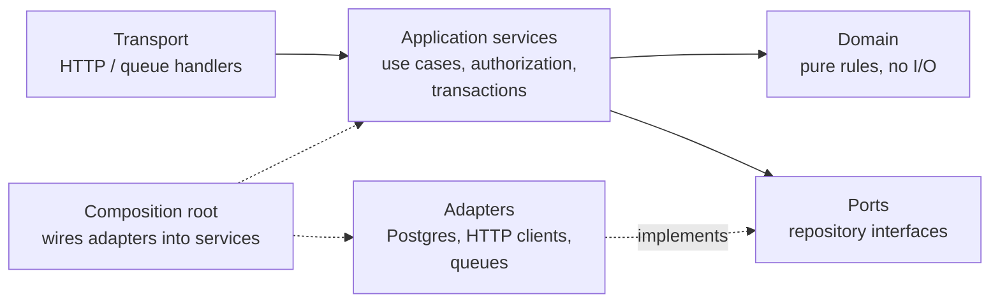

### 🔍 Worked example
TaskFlow's admin roster and a user's own dashboard both show "completion rate". Originally each
had its own SQL; months later, one excluded archived tasks and the other didn't, and managers saw
different numbers from their reports. Fix: one shared SQL fragment defining *which tasks count*,
used by both queries, with a test asserting the two endpoints agree for the same user.

### ✅ Best practices
- ✅ Thin transport, use-case services, pure domain, adapters at the edges.
- ✅ Constructor injection at a composition root; unit of work for transactions.
- ✅ Modules own their data; boundaries enforced in CI.
- ✅ One definition per business rule.
- ❌ Don't split into services before a concrete need.
- ❌ Don't add abstractions with a single trivial implementation and no reason.

### ⚠️ Pitfalls
- Shared database tables across services — a distributed monolith with none of the benefits.
- Business logic leaking into SQL in one place and into TypeScript in another.

### 🧠 Check yourself
1. Name three concrete reasons to extract a service from a monolith.
2. Where should a transaction boundary live, and why?

<details><summary>Answers</summary>

1. Independent scaling needs, a separate team/deploy cadence, fault isolation, compliance/data boundaries.
2. In the application service (use case), because only the use case knows which changes must succeed or fail together.
</details>

### 🛠️ Lab
Add an architecture test to a codebase that fails if any service imports the database client, and
refactor until it passes.

### 🔗 Go deeper
[The N+1 query problem](concepts/n-plus-one.md) · [Authorization models](concepts/authorization-models.md)

### 📌 Remember
- One-way dependencies; rules in the core; I/O at the edges.
- Modular monolith first; split with a reason.
- One source of truth per rule.

---

# Part II — Data

---

## Chapter 5 · PostgreSQL internals that matter

### 🎯 Outcomes
- Explain MVCC and its operational consequences (bloat, vacuum, long transactions)
- Understand connections and pooling at the database level
- Read the planner's mind well enough to predict query behaviour

### 🔁 Intuition check
Many engineers treat the database as a black box behind an ORM. Postgres rewards understanding its
engine: most production database incidents are about locks, connections, bloat or a bad plan — not
syntax.

### 📖 Core ideas

**MVCC (multi-version concurrency control).** An `UPDATE` doesn't overwrite a row; it writes a new
row version and marks the old one dead. Readers see a consistent snapshot without blocking writers.
Consequences:
- Dead tuples accumulate → **bloat**. **Autovacuum** reclaims them; tune it for hot tables.
- A **long-running transaction** (even an idle one left open) prevents vacuum from cleaning up
  anything newer than its snapshot → bloat grows everywhere. Monitor `pg_stat_activity` for
  `idle in transaction`.
- Transaction ID wraparound is prevented by vacuum freezing; neglected vacuum can eventually force
  emergency maintenance.

**Connections are expensive.** Each connection is a backend process with real memory. Hundreds of
connections hurt performance. With autoscaling app instances, use a pooler:
- **PgBouncer** (or the cloud provider's managed pooling) in **transaction mode** multiplexes many
  client connections onto few server connections.
- Transaction mode breaks session-scoped features: session `SET`, advisory locks held across
  transactions, `LISTEN/NOTIFY`, and (on older PgBouncer versions) named prepared statements. Use
  `SET LOCAL` inside transactions instead.
- Rule: `instances × pool_size ≤ max_connections − headroom`.

**The planner.** Postgres picks a plan from table statistics (`ANALYZE`). Bad estimates — stale
stats, correlated columns, skewed data — cause bad plans. Tools: `EXPLAIN (ANALYZE, BUFFERS)`,
`pg_stat_statements` for the most expensive queries overall, extended statistics for correlated
columns.

**WAL and durability.** Changes go to the write-ahead log before data files; replicas replay the
WAL. Heavy writes increase WAL volume, replication lag and backup size.

**Useful features you should reach for:** `jsonb` with GIN indexes, partial and expression indexes,
`INSERT … ON CONFLICT`, `RETURNING`, CTEs, window functions, generated columns, declarative
partitioning, `SKIP LOCKED`, row-level security, `LISTEN/NOTIFY` (lightweight signalling).

### ☁️ GCP ↔ AWS: managed PostgreSQL

| Concern | Google Cloud | AWS |
|---|---|---|
| Managed Postgres | Cloud SQL for PostgreSQL | Amazon RDS for PostgreSQL |
| Cloud-native, high-performance Postgres | AlloyDB | Aurora PostgreSQL |
| Passwordless (IAM) database login | Cloud SQL IAM database authentication | RDS / Aurora IAM database authentication |
| Connection pooling | Managed connection pooling (supported editions) or self-run PgBouncer | RDS Proxy, or self-run PgBouncer |
| Secure connection helper | Cloud SQL Auth Proxy / language connectors | RDS Proxy, or TLS directly to the endpoint |
| Read scaling | Read replicas | Read replicas / Aurora replicas |
| High availability | Regional (HA) instance | Multi-AZ deployment |
| Query insights | Query Insights | Performance Insights / Database Insights |
| Private connectivity | Private IP (private services access) or Private Service Connect | Instance in VPC subnets; access via security groups |

**Watch out:** the engines are the same Postgres, so everything in this chapter applies to both.
What differs is the edges — how you connect privately, how IAM login works, and which pooling
option you get.

### 🗺️ Picture it

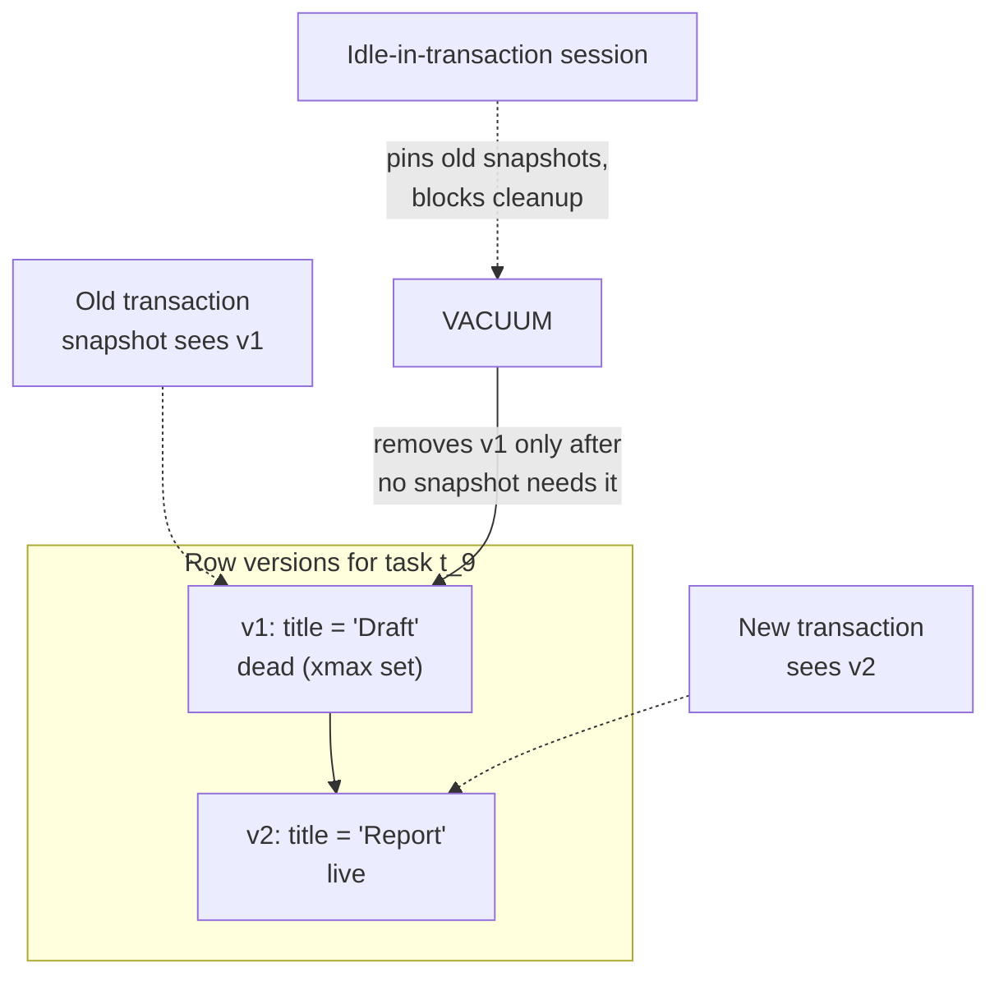

### 🔍 Worked example
TaskFlow's database CPU climbs every afternoon and queries slow down. `pg_stat_activity` shows a
reporting job holding a transaction open for six hours while it streams data. Vacuum can't remove
dead tuples created since it began; the hot `tasks` table bloats 4×. Fix: page the report in short
transactions (keyset pagination), set `idle_in_transaction_session_timeout`, and add an alert on
oldest-transaction age.

### ✅ Best practices
- ✅ Monitor long transactions, bloat, autovacuum activity and connection count.
- ✅ Pool connections; size pools against `max_connections`.
- ✅ Use `pg_stat_statements` to find what to optimize.
- ✅ Keep transactions short; set statement and idle-in-transaction timeouts.
- ❌ Don't open a connection per request without pooling.
- ❌ Don't leave transactions open across network calls or user think-time.

### ⚠️ Pitfalls
- Serverless/autoscaled apps exhausting `max_connections` during a traffic spike.
- Session-level settings silently leaking between clients behind a transaction-mode pooler.

### 🧠 Check yourself
1. Why can one idle-in-transaction session degrade the whole database?
2. What breaks when you put PgBouncer in transaction mode?
3. Where do you look first to find the queries worth optimizing?

<details><summary>Answers</summary>

1. Its snapshot pins old row versions, so vacuum can't reclaim dead tuples newer than it; bloat and slower scans follow across hot tables.
2. Anything relying on session state across transactions: session `SET`, session advisory locks, `LISTEN/NOTIFY`, and (on older versions) named prepared statements.
3. `pg_stat_statements`, sorted by total time — the biggest aggregate cost, not just the slowest single query.
</details>

### 🛠️ Lab
Open a transaction and leave it idle while running updates elsewhere; watch dead tuples grow with
`pg_stat_user_tables`. Then enable `pg_stat_statements` and find your top three queries by total time.

### 🔗 Go deeper
[MVCC and VACUUM](concepts/mvcc-and-vacuum.md) · [Connection pooling](concepts/connection-pooling.md) · [Reading EXPLAIN ANALYZE](sql/explain-analyze.md)

### 📌 Remember
- MVCC → dead tuples → vacuum; long transactions block it.
- Connections are expensive; pool them.
- Plans depend on statistics; measure with `pg_stat_statements`.

---

## Chapter 6 · Query performance and indexing

### 🎯 Outcomes
- Choose the right index type and column order for a workload
- Read `EXPLAIN (ANALYZE, BUFFERS)` and fix common bad plans
- Eliminate N+1 and other systemic performance bugs

### 🔁 Intuition check
The instinct to add a cache or a bigger machine comes first. The fix is usually cheaper: measure,
find the hot query, fix its cause.

### 📖 Core ideas

**Index types**

| Type | Use for |
|---|---|
| B-tree (default) | Equality, ranges, sorting, prefix `LIKE 'abc%'` |
| GIN | `jsonb` containment, arrays, full-text search |
| GiST | Geometric data, ranges, exclusion constraints, nearest-neighbour |
| BRIN | Huge, naturally ordered tables (append-only time series) — tiny and cheap |
| Hash | Equality only (rarely better than B-tree) |

**Designing B-tree indexes**
- **Column order:** equality columns first, then the range or sort column. `(org_id, status, created_at)` serves `WHERE org_id = ? AND status = ? ORDER BY created_at`.
- **Covering indexes:** `INCLUDE (title)` enables index-only scans for hot read paths.
- **Partial indexes:** `WHERE deleted_at IS NULL` or `WHERE status = 'open'` — smaller and faster for the queries that matter.
- **Expression indexes:** `ON lower(email)` for case-insensitive lookups.
- Every index slows writes and needs vacuum — remove unused ones (`pg_stat_user_indexes`).

**Reading plans.** In `EXPLAIN (ANALYZE, BUFFERS)` look for:
- `Seq Scan` on large tables in hot queries.
- Estimated vs actual rows off by orders of magnitude → stale or insufficient statistics.
- `Nested Loop` with a huge outer side; large sorts spilling to disk; high shared-buffer reads.

**Systemic performance bugs**
1. **N+1** — batch with joins or `WHERE id = ANY($1)`; use dataloaders in GraphQL.
2. **Unbounded queries** — always paginate; cap limits server-side.
3. **Correlated subqueries per row** on large sets — rewrite as joins or lateral joins with indexes.
4. **Functions on indexed columns** in predicates.
5. **Counting** large filtered sets on every request — cache, approximate, or drop the total.

### 🗺️ Picture it

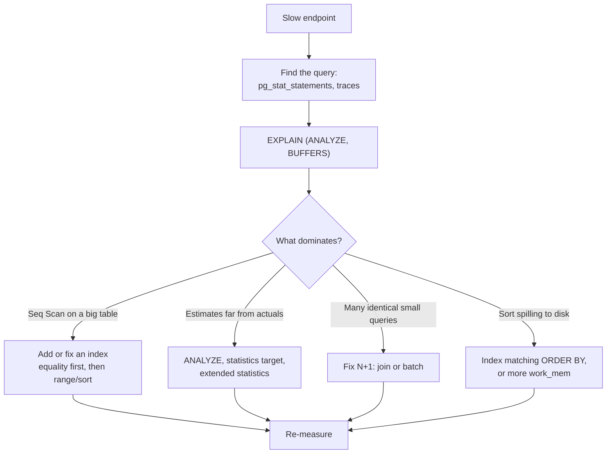

### 🔍 Worked example
"Open tasks for my team, newest first" takes 900 ms on 20M rows. The plan shows a sequential scan
filtering by `team_id` and `status`, then a sort. A partial composite index:
```sql
CREATE INDEX CONCURRENTLY tasks_open_by_team ON tasks (team_id, created_at DESC) WHERE status = 'open';
```
turns it into an index scan that reads exactly 50 rows: 2 ms.

### ✅ Best practices
- ✅ Index for real access patterns; equality before range in composite order.
- ✅ Partial, covering and expression indexes where they fit.
- ✅ `CREATE INDEX CONCURRENTLY` on live tables.
- ✅ Track `pg_stat_statements` and unused indexes.
- ❌ Don't index every column "just in case".
- ❌ Don't trust local-dataset performance; test with production-like volumes.

### ⚠️ Pitfalls
- `CREATE INDEX` without `CONCURRENTLY` locking writes on a hot table.
- ORMs generating N+1 or `SELECT *` silently.

### 🧠 Check yourself
1. Which index serves `WHERE org_id = ? AND created_at > ? ORDER BY created_at`: `(created_at, org_id)` or `(org_id, created_at)`?
2. When would BRIN beat B-tree?
3. Estimated 10 rows, actual 2M. What's likely wrong and how do you fix it?

<details><summary>Answers</summary>

1. `(org_id, created_at)` — equality column first, then the range/sort column.
2. Very large tables where values correlate with physical order (append-only by time); BRIN is tiny and cheap to maintain.
3. Stale or insufficient statistics (or correlated columns). Run `ANALYZE`, raise the statistics target, or add extended statistics.
</details>

### 🛠️ Lab
Load 10M rows, capture plans for five realistic queries, design indexes, and record before/after
timings and buffer reads.

### 🔗 Go deeper
[Indexing](concepts/indexing.md) · [The N+1 query problem](concepts/n-plus-one.md) · [Reading EXPLAIN ANALYZE](sql/explain-analyze.md) · [Joins](sql/joins.md) · [Aggregation](sql/aggregation.md) · [NULLs and gotchas](sql/nulls-and-gotchas.md)

### 📌 Remember
- Right index type; right column order; partial and covering where useful.
- `EXPLAIN (ANALYZE, BUFFERS)` and `pg_stat_statements`.
- Kill N+1, bound everything.

---

## Chapter 7 · Transactions, isolation and locking

### 🎯 Outcomes
- Explain each isolation level and the anomalies it allows
- Use locks deliberately and avoid lock-related outages
- Build correct concurrent workflows, including job queues on Postgres

### 🔁 Intuition check
"It's in a transaction, so it's safe" is the most common assumption here — and often wrong. In a
database, race conditions mean corrupted balances, double bookings and duplicate emails.

### 📖 Core ideas

**Isolation levels in Postgres**

| Level | What you get | Anomalies still possible |
|---|---|---|
| Read Committed (default) | Each statement sees data committed before it began | Non-repeatable reads, lost updates (read-modify-write), write skew |
| Repeatable Read | One snapshot for the whole transaction (snapshot isolation) | **Write skew** |
| Serializable (SSI) | As if transactions ran one at a time | None — but transactions can fail with `40001` and must be retried |

**Write skew**, the anomaly people miss: two transactions each read a condition ("at least one
admin remains"), each change different rows, and together violate it. Prevent with `SERIALIZABLE`
(plus retries), an explicit lock on a shared row, or a constraint that captures the rule.

**Tools for correctness, in order of preference**
1. **Constraints** — `UNIQUE`, `CHECK`, foreign keys, exclusion constraints. The database enforces them under any concurrency.
2. **Atomic statements** — `UPDATE … SET n = n + 1`, `INSERT … ON CONFLICT`.
3. **Optimistic concurrency** — a `version` column checked in `WHERE`.
4. **Pessimistic locks** — `SELECT … FOR UPDATE` (or `FOR NO KEY UPDATE`) on the rows you'll change.
5. **Advisory locks** — application-defined mutexes (`pg_advisory_xact_lock`) for "only one at a time" jobs.
6. **Serializable isolation** with a retry loop for complex invariants.

**Lock hazards**
- **Deadlocks:** take locks in a consistent order; keep transactions short. Postgres detects and aborts one side — be ready to retry.
- **DDL lock queues:** `ALTER TABLE` needs a strong lock; if it waits behind a long query, *every*
  query queues behind it and the app stalls. Always set `lock_timeout` for migrations and retry.
- **Holding locks across network calls** (HTTP, email) stretches transactions and blocks others.

**Postgres as a job queue.** `SELECT … FOR UPDATE SKIP LOCKED` lets multiple workers claim
different jobs without blocking each other:
```sql
WITH next AS (
  SELECT id FROM jobs WHERE status = 'queued' AND run_at <= now()
  ORDER BY run_at FOR UPDATE SKIP LOCKED LIMIT 10
)
UPDATE jobs SET status = 'running', locked_at = now()
FROM next WHERE jobs.id = next.id RETURNING jobs.*;
```

### 🗺️ Picture it

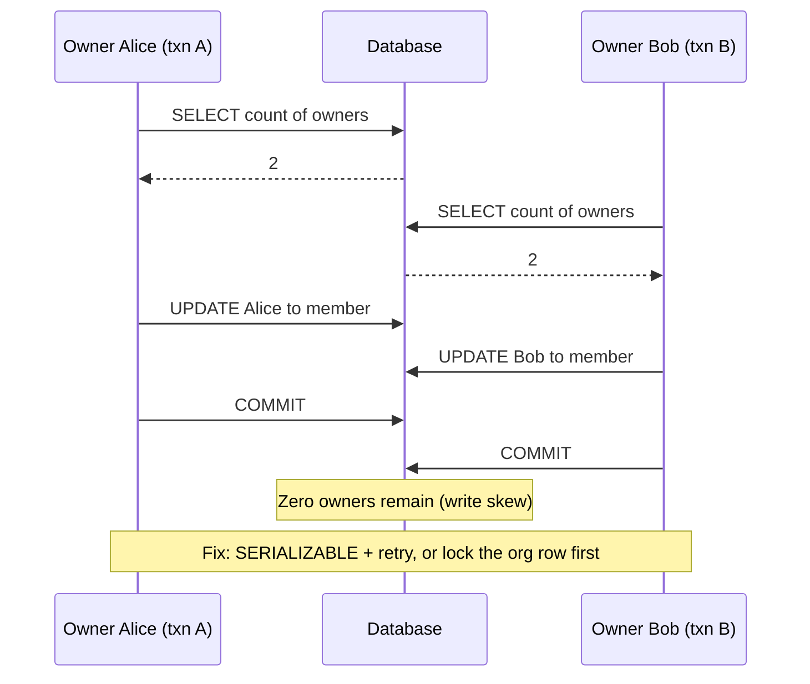

### 🔍 Worked example
TaskFlow rule: an org must always have at least one owner. Two owners simultaneously demote each
other. Under Read Committed, each transaction sees "two owners, safe to demote one" — both commit,
zero owners remain (write skew). Fix options: run the use case at `SERIALIZABLE` with a retry
wrapper; or lock the org row (`SELECT … FROM orgs WHERE id = $1 FOR UPDATE`) at the start of any
owner change so the two changes serialize.

### ✅ Best practices
- ✅ Encode invariants as constraints wherever possible.
- ✅ Prefer atomic statements and optimistic concurrency; lock deliberately when needed.
- ✅ Retry on serialization failures and deadlocks, with backoff.
- ✅ `lock_timeout` and `statement_timeout` for migrations and risky operations.
- ✅ `SKIP LOCKED` for work queues.
- ❌ Don't hold transactions open across external calls.
- ❌ Don't assume Read Committed protects multi-row invariants.

### ⚠️ Pitfalls
- A migration waiting for a lock and taking the entire app down behind it.
- Read-modify-write in application code losing updates under load.

### 🧠 Check yourself
1. Give an example of write skew and two ways to prevent it.
2. Why should every migration set `lock_timeout`?
3. What does `SKIP LOCKED` change about concurrent workers?

<details><summary>Answers</summary>

1. Two on-call engineers each check "someone else is on call" and both go off call. Prevent with `SERIALIZABLE` + retry, or by locking a shared row (e.g. the rota) before changing it.
2. A DDL waiting on a strong lock blocks all later queries on that table; a short `lock_timeout` makes it fail fast and retry instead of stalling the app.
3. Workers skip rows already locked by others instead of waiting, so they claim different jobs in parallel.
</details>

### 🛠️ Lab
Reproduce write skew with two concurrent sessions, then fix it twice: once with `SERIALIZABLE`
and a retry loop, once with a row lock. Build a `SKIP LOCKED` worker pool and run three workers.

### 🔗 Go deeper
[Isolation levels and write skew](concepts/isolation-levels-and-write-skew.md) · [Locks and SKIP LOCKED](sql/locking-and-skip-locked.md) · [Optimistic concurrency](concepts/optimistic-concurrency-etags.md)

### 📌 Remember
- Know your isolation level's anomalies; write skew is real.
- Constraints → atomic statements → optimistic → pessimistic → serializable.
- `lock_timeout` on migrations; `SKIP LOCKED` for queues.

---

## Chapter 8 · Schema evolution and data modelling

### 🎯 Outcomes
- Model data with patterns that keep history and integrity
- Ship schema changes with zero downtime
- Plan backfills and large data changes safely

### 🔁 Intuition check
Changing a type in code is a refactor. Changing a production schema is a migration of live data
that old and new code read at the same time.

### 📖 Core ideas

**Modelling patterns**

| Pattern | Use | Trade-off |
|---|---|---|
| Audit columns (`created_*`, `updated_*`) | Always | Trivial cost |
| Soft delete + partial unique indexes | Undo, history, reuse of business keys | Every query must filter |
| Append-only event tables (current state = latest event) | Assignments, status history, audit | Reads need "latest per key" queries |
| Event sourcing | Full history is the product | High complexity; projections to maintain |
| Outbox table | Reliable event publishing | A relay process to run |
| `jsonb` attributes | Truly variable fields | Weaker constraints; index carefully |
| Partitioning (by time or tenant) | Very large tables, retention by dropping partitions | Planning and maintenance overhead |
| UUIDv7 / ULID keys | Globally unique, roughly time-ordered | Larger than integers |

**Zero-downtime migrations.** During a rollout, old and new code run against the same schema.
Every step must be compatible with both. **Expand → migrate → contract:**
1. **Expand:** add the new structure (nullable column, new table, new index *concurrently*). Deploy code that writes to both old and new.
2. **Migrate:** backfill in batches; verify; switch reads to the new structure.
3. **Contract:** stop writing the old; drop it in a later release.

**Operational rules for migrations**
- `lock_timeout` on every migration; retry rather than queue.
- Adding a column with a constant default is fast in modern Postgres (11+); adding `NOT NULL` to a
  big table is safer as `CHECK (col IS NOT NULL) NOT VALID` → `VALIDATE CONSTRAINT` → then `SET NOT NULL`.
- Indexes: `CREATE INDEX CONCURRENTLY` (it can't run inside a transaction block).
- Backfills: batches of a few thousand rows by primary-key range, with pauses; idempotent so they can resume.
- **Never edit a merged migration;** add a new one.
- Run migrations from CI as a deploy step, not from laptops.

**ORMs.** Use them for CRUD and schema/migration tooling; drop to parameterized SQL for reporting,
bulk operations and anything performance-sensitive. Log generated SQL in development.

### 🗺️ Picture it

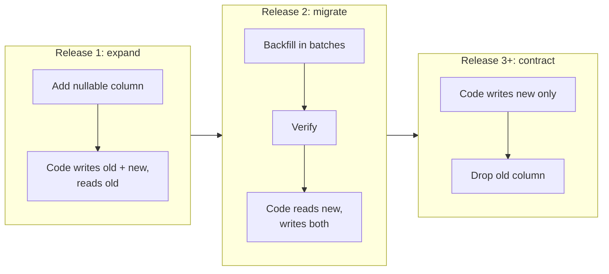

### 🔍 Worked example
TaskFlow needs to split `tasks.assignee` (a text email) into `assignee_id` (a foreign key).
1. Expand: add nullable `assignee_id`; deploy code writing both.
2. Migrate: backfill `assignee_id` in batches of 5k by id range; add the FK as `NOT VALID`, then `VALIDATE`.
3. Switch reads to `assignee_id`; monitor.
4. Contract: next release stops writing `assignee`; a later migration drops it.
At no point is there downtime or a long lock.

### ✅ Best practices
- ✅ Choose patterns deliberately: events for history, soft delete for undo, outbox for events.
- ✅ Expand → migrate → contract for every breaking change.
- ✅ `lock_timeout`, `CONCURRENTLY`, `NOT VALID` + `VALIDATE`, batched backfills.
- ✅ Migrations reviewed like code and applied by CI.
- ❌ Don't rename or drop columns in the same release as the code change.
- ❌ Don't run one giant `UPDATE` over millions of rows.

### ⚠️ Pitfalls
- A "simple" `ALTER TABLE` holding an exclusive lock for minutes.
- Forgetting the soft-delete filter in a new query and showing deleted records.

### 🧠 Check yourself
1. Why can't you rename a column in a single deploy?
2. How do you add `NOT NULL` to a 100M-row table without a long lock?
3. Why must backfills be idempotent?

<details><summary>Answers</summary>

1. Old code still running during the rollout reads/writes the old name and breaks.
2. Add `CHECK (col IS NOT NULL) NOT VALID`, `VALIDATE CONSTRAINT` (which takes a weaker lock), then `SET NOT NULL`, which can use the validated check.
3. They fail and restart; reprocessing rows must not corrupt data.
</details>

### 🛠️ Lab
Perform a column split with expand/migrate/contract on a 5M-row table while a load test runs;
confirm zero errors.

### 🔗 Go deeper
[Zero-downtime migrations](concepts/zero-downtime-migrations.md) · [Window functions (latest-per-group for event tables)](sql/window-functions.md) · [Upserts and RETURNING](sql/upserts-and-returning.md) · [CTEs and subqueries](sql/ctes-and-subqueries.md)

### 📌 Remember
- Pick modelling patterns on purpose.
- Expand → migrate → contract.
- Lock timeouts, concurrent indexes, validated constraints, batched backfills.

---

## Chapter 9 · Caching and data beyond Postgres

### 🎯 Outcomes
- Decide when another datastore is justified
- Design caches with explicit consistency and invalidation strategies
- Separate operational and analytical workloads

### 🔁 Intuition check
Caching looks like a free speed-up. On a server it adds multiple writers, multiple instances and
real consequences for stale data — so freshness and invalidation have to be designed, not hoped for.

### 📖 Core ideas

**Choosing a datastore.** Start with Postgres; add a store for a specific need:

| Need | Typical choice |
|---|---|
| Hot key-value, rate limits, ephemeral state | Redis |
| Full-text search, relevance, facets | OpenSearch / Elasticsearch (fed from Postgres) |
| Massive write throughput with known access patterns | DynamoDB, Cassandra, Bigtable |
| Analytics over billions of rows | BigQuery, Snowflake, Redshift, ClickHouse |
| Files and blobs | Object storage |

Every extra store adds consistency questions (how does it stay in sync?) and operational cost.
Feed secondary stores from the source of truth via CDC (change data capture) or the outbox, not
dual writes from request handlers.

**OLTP vs OLAP.** Keep analytics off the primary: replicate to a warehouse, or at least to a read
replica, and accept freshness lag.

**Caching strategies**
- **Cache-aside** (lazy): read cache → miss → load → populate. Simple, most common.
- **Write-through:** write cache with the database. Fresher, more write cost.
- **Stale-while-revalidate:** serve stale and refresh in the background.
- **Negative caching:** cache "not found" briefly to protect against repeated misses.

**Consistency and invalidation**
- Decide the **staleness budget** per data type before caching.
- Invalidate on write (delete keys after commit), version keys (`stats:v3:user:42`), or rely on short TTLs.
- **Stampede protection:** single-flight locks, jittered TTLs, early probabilistic refresh.
- **Hot keys:** shard or replicate them; add local in-process caching for ultra-hot reads.
- **Never** cache per-user or per-tenant data under a shared key, and never at a shared CDN layer without correct `Vary`/`private` headers.

### ☁️ GCP ↔ AWS: caches and other datastores

| Need | Google Cloud | AWS |
|---|---|---|
| Managed Redis / Valkey | Memorystore | ElastiCache / MemoryDB |
| Document / key-value (serverless) | Firestore | DynamoDB |
| Wide-column, huge throughput | Bigtable | DynamoDB (or Keyspaces for Cassandra) |
| Search | Self-run OpenSearch/Elasticsearch or Vertex AI Search | Amazon OpenSearch Service |
| Data warehouse | BigQuery | Redshift (+ Athena for queries over S3) |
| Change data capture | Datastream | AWS DMS |
| Object storage | Cloud Storage | S3 |
| CDN | Cloud CDN | CloudFront |

### 🗺️ Picture it

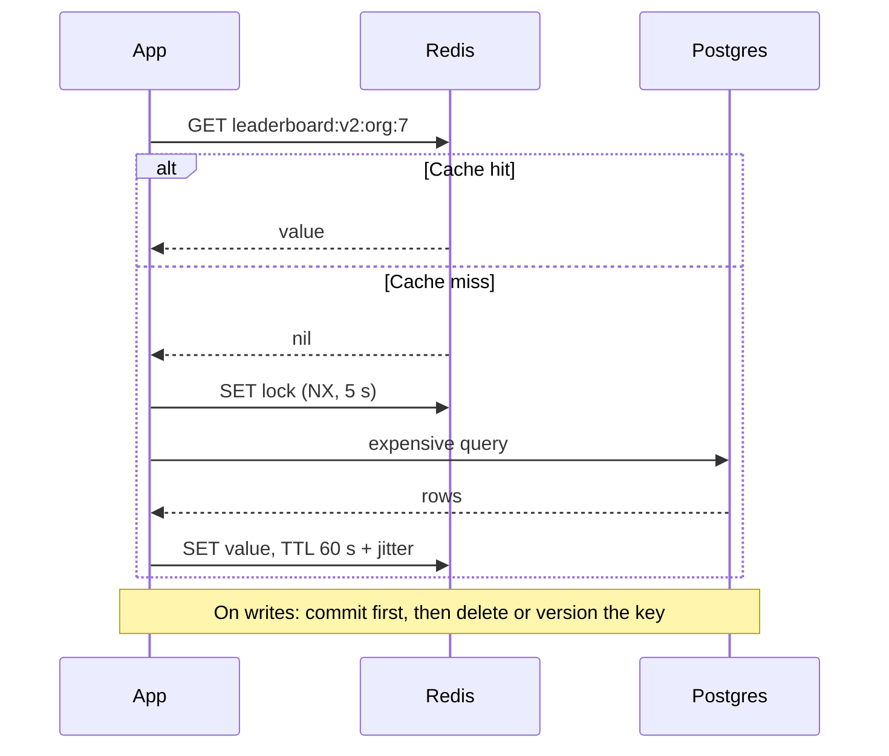

### 🔍 Worked example
TaskFlow's org leaderboard scans millions of rows and takes 3 s. Product accepts a 60-second
staleness. Implementation: cache-aside in Redis under `leaderboard:v2:org:<id>`, TTL 60 s ± 10 s
jitter, single-flight rebuild with a short Redis lock. P99 drops to 15 ms; the database sees one
rebuild per org per minute instead of thousands.

### ✅ Best practices
- ✅ Postgres first; justify every additional store with a concrete requirement.
- ✅ Sync secondary stores from the source of truth (CDC/outbox).
- ✅ Explicit staleness budgets; versioned keys; stampede protection.
- ✅ Analytics off the primary.
- ❌ Don't dual-write to two stores from a request handler and hope they agree.
- ❌ Don't cache to hide a missing index.

### ⚠️ Pitfalls
- Invalidating the cache before the transaction commits → readers repopulate it with old data.
- A shared CDN caching an authenticated response.

### 🧠 Check yourself
1. Why invalidate after commit rather than before?
2. What problem does change data capture solve compared with dual writes?

<details><summary>Answers</summary>

1. If you invalidate first, a concurrent read can reload the old (still committed) value into the cache before your transaction commits.
2. Dual writes can partially fail and diverge; CDC derives the secondary store from the committed log of the source of truth.
</details>

### 🛠️ Lab
Add a cache-aside layer with versioned keys, jittered TTLs and single-flight rebuilds; load test a
cold start and observe database queries.

### 🔗 Go deeper
[Caching strategies](concepts/caching-strategies.md) · [CAP and PACELC](concepts/cap-and-pacelc.md)

### 📌 Remember
- Postgres first; add stores with reasons.
- Feed derived stores from the source of truth.
- Staleness budget, invalidation after commit, stampede protection.

---

# Part III — Distributed systems

---

## Chapter 10 · Messaging, events and async workflows

### 🎯 Outcomes
- Choose between queues, streams and pub/sub
- Publish events reliably and consume them idempotently
- Orchestrate multi-step workflows without distributed transactions

### 🔁 Intuition check
Async processing feels like "do it later". In reality messages are delayed, duplicated and
reordered — and a duplicated message can charge a card twice.

### 📖 Core ideas

**Primitives**

| Primitive | Semantics | Examples |
|---|---|---|
| Work queue | Each message processed by one consumer | SQS, Cloud Tasks, RabbitMQ, Postgres `SKIP LOCKED` |
| Pub/sub | Each subscriber gets every message | SNS, Google Pub/Sub, EventBridge |
| Log/stream | Ordered, replayable, partitioned | Kafka, Kinesis, Pub/Sub Lite |

**Delivery semantics.** Assume **at-least-once**: messages will be redelivered. "Exactly-once" in
practice = at-least-once delivery + **idempotent processing** (dedupe by message/event id, or
naturally idempotent operations like upserts).

**Reliable publishing: the transactional outbox.** Writing to the database and publishing to a
broker are two systems; you can't commit both atomically. Instead:
1. In the business transaction, insert into an `outbox` table.
2. A relay (polling with `SKIP LOCKED`, or CDC) publishes outbox rows and marks them sent.
3. Consumers dedupe by event id.

**Ordering.** Usually per key at best (Kafka partition, Pub/Sub ordering key). Design consumers to
tolerate reordering (versions, timestamps from a single source, "latest wins" with care).

**Failure handling.** Exponential backoff with jitter, max attempts, **dead-letter queue** with
alerting and a replay tool. Distinguish transient errors (retry) from permanent ones (dead-letter
immediately).

**Workflows across services: sagas.** A sequence of local transactions, each with a compensating
action if a later step fails.
- **Choreography:** services react to each other's events. Loosely coupled; hard to see the whole flow.
- **Orchestration:** a coordinator drives steps (Temporal, Step Functions, Cloud Workflows). Explicit, observable, easier to change.

**Schema evolution for events.** Events are contracts too: version them, only add fields,
document them, and keep consumers tolerant of unknown fields.

### ☁️ GCP ↔ AWS: messaging and workflows

| Need | Google Cloud | AWS |
|---|---|---|
| Pub/sub fan-out | Pub/Sub (topics + subscriptions) | SNS (often fanning out to SQS) |
| Work queue | Pub/Sub pull subscription, or Cloud Tasks for HTTP task dispatch | SQS (Standard, or FIFO for ordering + dedupe) |
| Ordering | Pub/Sub ordering keys | SQS FIFO message groups; Kinesis shards |
| Dedupe / exactly-once help | Pub/Sub exactly-once delivery (pull subscriptions) | SQS FIFO deduplication |
| Dead-letter queue | Pub/Sub dead-letter topic | SQS dead-letter queue (redrive policy) |
| Event routing | Eventarc | EventBridge |
| Streaming log | Pub/Sub, or Managed Service for Apache Kafka | Kinesis, or Amazon MSK (Kafka) |
| Workflow orchestration | Workflows | Step Functions |
| Scheduled jobs | Cloud Scheduler | EventBridge Scheduler |

**Watch out:** an AWS "queue" (SQS) and "topic" (SNS) are separate services; on Google Cloud, Pub/Sub
covers both roles through subscriptions. Whatever the guarantees, keep consumers idempotent.

### 🗺️ Picture it

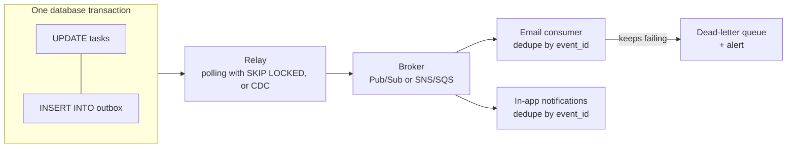

### 🔍 Worked example
Assigning a task must notify the assignee by email and in-app. The use case updates the task and
inserts `outbox(event_id, type='task.assigned', payload)` in one transaction. A relay publishes to
a topic. The email consumer stores `processed_event(event_id)` with a unique constraint in the same
transaction as recording the send — a redelivered event hits the constraint and is skipped. An email
provider outage sends events through backoff and, after N attempts, to a dead-letter queue that
pages on-call.

### ✅ Best practices
- ✅ Outbox for publishing; idempotent consumers keyed by event id.
- ✅ Backoff with jitter, attempt limits, dead-letter queues with alerts and replay.
- ✅ Prefer orchestration for business-critical multi-step workflows.
- ✅ Version events; additive changes only.
- ❌ Don't publish to a broker inside a database transaction and assume both happened.
- ❌ Don't rely on global ordering.

### ⚠️ Pitfalls
- Poison messages retried forever, blocking a partition.
- Consumers with side effects that aren't idempotent.

### 🧠 Check yourself
1. Why doesn't "publish after commit" in application code guarantee delivery?
2. Choreography or orchestration for a refund flow spanning payments, inventory and email? Why?

<details><summary>Answers</summary>

1. The process can crash between commit and publish; the change is committed but the event is lost. The outbox makes publishing part of the committed data.
2. Usually orchestration: it's business-critical, needs compensation logic and visibility, and changes over time.
</details>

### 🛠️ Lab
Implement an outbox with a `SKIP LOCKED` relay and an idempotent consumer. Kill the relay and
consumer at random points during a load test; verify no event is lost or applied twice.

### 🔗 Go deeper
[Outbox pattern](concepts/outbox-pattern.md) · [Sagas](concepts/sagas.md) · [Idempotency](concepts/idempotency.md) · [Locks and SKIP LOCKED](sql/locking-and-skip-locked.md)

### 📌 Remember
- At-least-once is the reality; make consumers idempotent.
- Outbox for reliable publishing.
- Sagas with compensation; prefer orchestration for critical flows.

---

## Chapter 11 · Failure, resilience and consistency

### 🎯 Outcomes
- Design for partial failure across network boundaries
- Apply timeouts, retries, circuit breakers and load shedding correctly
- Reason about consistency trade-offs explicitly

### 🔁 Intuition check
A failed call looks like a simple error to handle. In distributed systems a dependency can be slow,
half-working or ambiguous about what it did — and naive retries can make it worse.

### 📖 Core ideas

**The network is unreliable.** Requests are lost, duplicated, delayed and reordered. A timeout
tells you nothing about whether the other side acted.

**Resilience patterns**
- **Timeouts** on every call, set from the dependency's latency profile and your own deadline.
  Propagate **deadlines** downstream so work stops when the caller has given up.
- **Retries** only for idempotent or idempotency-keyed operations, with exponential backoff +
  jitter, a cap, and a **retry budget** (e.g. retries ≤ 10% of requests) to prevent retry storms.
- **Circuit breakers** stop calling a failing dependency and fail fast, probing periodically.
- **Bulkheads** isolate resources (separate pools per dependency) so one failure can't exhaust everything.
- **Load shedding** rejects excess work early (`503` + `Retry-After`) to protect latency for the rest.
- **Graceful degradation** serves partial results when non-critical dependencies fail.
- **Hedged requests** (send a second request after the p95) cut tail latency for idempotent reads, at extra cost.

**Consistency trade-offs**
- **CAP:** during a partition, choose consistency (refuse) or availability (serve possibly stale).
- **PACELC:** even without partitions, you trade latency against consistency.
- **Read-your-writes** matters most for UX: after a write, route that user's reads to the primary or wait for the replica to catch up.
- Make the choice per operation: money and permissions need strong consistency; feeds and counters tolerate eventual consistency.

**Little's Law** — `concurrency = throughput × latency`. If latency doubles at constant throughput,
concurrency (connections, threads, memory) doubles too. That's how a slow dependency exhausts pools
and cascades into an outage.

### 🗺️ Picture it

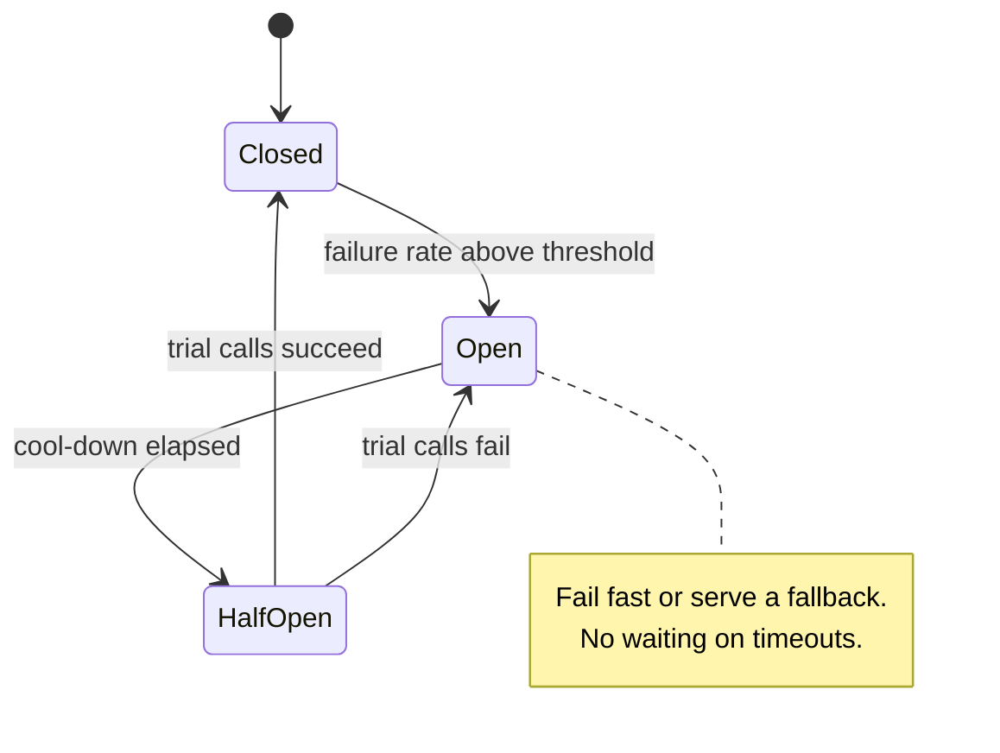

### 🔍 Worked example
TaskFlow calls a calendar API with a 30-second default timeout and three immediate retries. The
calendar slows to 20 s. At 200 requests/s, Little's Law gives `200 × 20 = 4,000` in-flight calls;
pools exhaust, every endpoint slows, and retries triple the load on the struggling calendar. The
fix: a 1.5 s timeout, one retry with jittered backoff inside a retry budget, a circuit breaker, a
bulkhead pool for calendar calls, and degraded UI ("calendar unavailable"). The rest of TaskFlow
stays fast during the next calendar incident.

### ✅ Best practices
- ✅ Timeouts and deadline propagation everywhere.
- ✅ Retries only when safe; backoff + jitter + retry budgets.
- ✅ Circuit breakers, bulkheads and load shedding for critical paths.
- ✅ Choose consistency per operation; provide read-your-writes for users.
- ❌ Don't retry at every layer (multiplicative retries).
- ❌ Don't let a non-critical dependency take down a critical path.

### ⚠️ Pitfalls
- Retry storms that turn a brief blip into a sustained outage.
- Reading from a lagging replica right after a write and showing users stale data.

### 🧠 Check yourself
1. Three layers each retry 3 times. A request fails at the bottom. How many bottom-layer attempts happen?
2. Use Little's Law: 500 req/s at 40 ms latency needs how many concurrent slots? At 400 ms?

<details><summary>Answers</summary>

1. Up to 4 × 4 × 4 = 64 attempts (each layer makes 1 + 3 tries). Retry at one layer only.
2. 500 × 0.04 = 20; 500 × 0.4 = 200.
</details>

### 🛠️ Lab
Put a fault-injecting proxy (e.g. Toxiproxy) between a service and a dependency. Add latency and
errors; measure the blast radius before and after adding timeouts, a breaker and a bulkhead.

### 🔗 Go deeper
[Retries, backoff and jitter](concepts/retries-backoff-jitter.md) · [Circuit breakers, bulkheads and load shedding](concepts/circuit-breakers-bulkheads-load-shedding.md) · [Little's Law](concepts/littles-law.md) · [CAP and PACELC](concepts/cap-and-pacelc.md)

### 📌 Remember
- Timeouts, deadlines, safe retries with budgets.
- Breakers, bulkheads, load shedding, degradation.
- Little's Law explains cascades; choose consistency per operation.

---

# Part IV — Operating software

---

## Chapter 12 · Testing backends properly

### 🎯 Outcomes
- Build a test suite that catches data, concurrency and authorization bugs
- Use real infrastructure in tests efficiently
- Test contracts between services

### 🔁 Intuition check
Unit tests with mocks feel thorough. On the backend, the highest-value tests run against real
databases — mocks hide most of the bugs that matter.

### 📖 Core ideas
- **Unit tests** for pure domain logic and edge-heavy functions.
- **Integration tests with real dependencies:** Postgres (and Redis/queues) in containers
  (Testcontainers, Docker Compose in CI). Mocked databases don't run your SQL, constraints or locks.
- **Route/API tests** through the real app (supertest or equivalent) for each endpoint:
  happy path, **every auth failure** (no identity, wrong role, other tenant, other user's object),
  **every documented error code**, empty states, and rule edges.
- **Contract tests** between services (Pact, schema tests on OpenAPI/event schemas) so producers
  can't break consumers.
- **Concurrency tests:** fire parallel requests at invariants (no double booking, no lost updates).
- **Migration tests:** run all migrations from zero in CI; test expand/contract steps.
- **Property-based tests** (fast-check) for parsers, pricing and permission logic.
- **Load tests** (k6, Gatling) before launches and after major changes.

**Keeping suites fast and reliable:** isolate data per test (unique ids or rollback-per-test),
truncate between files, freeze time, seed randomness, parallelize safely. Flaky tests are bugs —
reproduce, fix or quarantine with an owner.

### 🗺️ Picture it

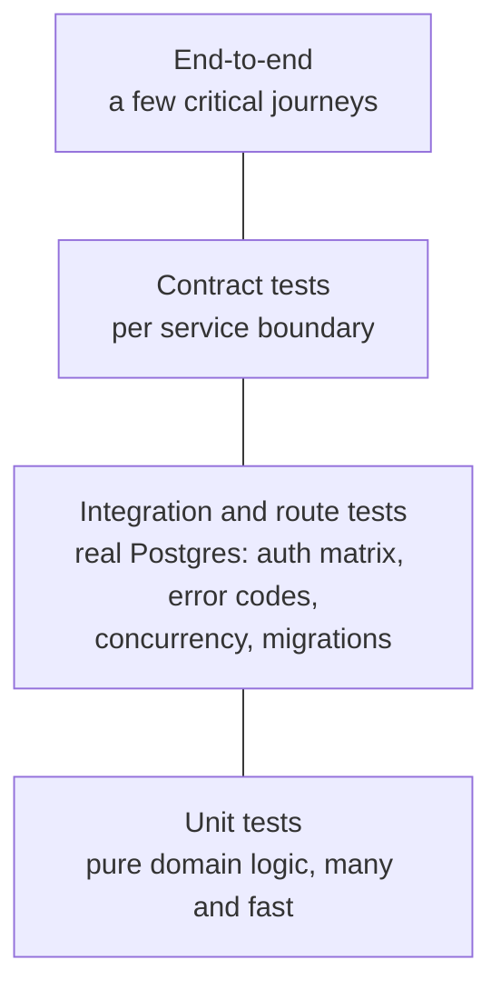

### 🔍 Worked example
TaskFlow's "assign task" passed all unit tests with mocked repositories. In production two
assignments raced and both succeeded. A route test now fires 20 concurrent assignments against a
real Postgres and asserts exactly one wins; it failed until the use case added a version check.

### ✅ Best practices
- ✅ Real databases for data-access and route tests.
- ✅ Test authorization and error codes per endpoint.
- ✅ Concurrency and migration tests for critical paths.
- ✅ Contract tests at service boundaries.
- ❌ Don't mock what you don't own (ORMs, drivers) to test SQL logic.
- ❌ Don't tolerate flaky tests.

### ⚠️ Pitfalls
- High coverage of happy paths, zero coverage of authorization.
- Tests sharing data and passing only in a particular order.

### 🧠 Check yourself
1. Name four negative cases every authenticated endpoint should test.
2. Why are migration tests worth running in CI?

<details><summary>Answers</summary>

1. No identity, wrong role, another tenant's resource, another user's object (plus invalid input).
2. They catch broken or non-reproducible migrations before they reach a shared environment, and verify the schema the code expects.
</details>

### 🛠️ Lab
Add a concurrency test and a full authorization matrix test to one critical endpoint.

### 🔗 Go deeper
[Isolation levels and write skew](concepts/isolation-levels-and-write-skew.md) · [Authorization models](concepts/authorization-models.md)

### 📌 Remember
- Real infrastructure in tests.
- Authorization, error codes, concurrency, migrations.
- Contracts between services; no flaky tests.

---

## Chapter 13 · Observability and SLOs

### 🎯 Outcomes
- Instrument services with logs, metrics and traces that answer real questions
- Define SLOs and alert on error-budget burn
- Debug production issues systematically

### 🔁 Intuition check
In development you have a debugger. In production you only have what you instrumented — and you're
the one paged at 3 a.m.

### 📖 Core ideas

**Three signals, correlated**
- **Logs:** structured JSON; `trace_id`/`request_id`, user/tenant ids, route, latency; levels used consistently; secrets and sensitive data redacted by configuration.
- **Metrics:** **RED** for services (Rate, Errors, Duration) and **USE** for resources (Utilization, Saturation, Errors). Histograms for latency (p50/p95/p99), never just averages.
- **Traces:** distributed tracing with **OpenTelemetry**, propagating context (W3C `traceparent`) across HTTP and queues.

**Cardinality.** Metric labels like `user_id` explode storage and cost. Put high-cardinality data in
logs and traces, not metric labels.

**SLOs**
- **SLI:** e.g. proportion of requests that succeed in < 300 ms.
- **SLO:** e.g. 99.9% over 30 days → an **error budget** of 0.1% (~43 minutes/month).
- **Burn-rate alerting:** alert when the budget is being consumed too fast, not on raw thresholds.
  A common pattern (from Google's SRE Workbook) pages when the 1-hour burn rate exceeds 14.4× (2% of
  a 30-day budget in an hour) **and** a short window (5 minutes) confirms it's still happening, with
  slower windows for ticket-level alerts.

### ☁️ GCP ↔ AWS: observability

| Need | Google Cloud | AWS |
|---|---|---|
| Logs | Cloud Logging | CloudWatch Logs |
| Metrics and dashboards | Cloud Monitoring | CloudWatch Metrics / Dashboards |
| Managed Prometheus | Google Cloud Managed Service for Prometheus | Amazon Managed Service for Prometheus |
| Tracing | Cloud Trace | AWS X-Ray (or CloudWatch Application Signals) |
| SLO monitoring | Cloud Monitoring SLOs | CloudWatch Application Signals SLOs |
| Error tracking | Error Reporting | CloudWatch / third-party tools |
| Audit logs of admin actions | Cloud Audit Logs | AWS CloudTrail |
| Instrumentation that works on both | OpenTelemetry | OpenTelemetry (AWS Distro for OpenTelemetry) |

**Tip:** instrument with OpenTelemetry and you can switch backends — or clouds — without
re-instrumenting your code.

**Debugging method**
1. What changed? (deploys, config, traffic, dependencies)
2. Where? RED metrics by route, region, version.
3. Why? Traces of slow/failed requests → logs for those trace ids.
4. Mitigate first (rollback, shed load, disable a feature flag), then root-cause.

### 🗺️ Picture it

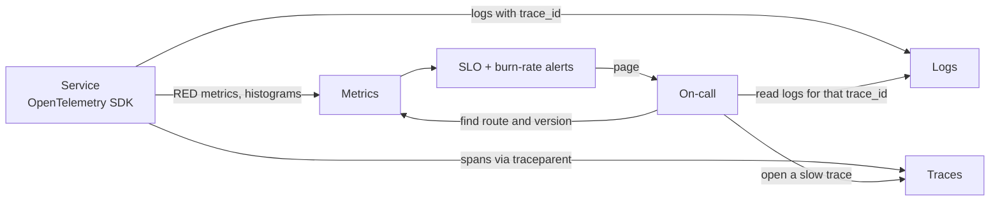

### 🔍 Worked example
Alert: 1-hour burn rate 20× on TaskFlow's API. Dashboard: errors concentrated on `POST /tasks`,
starting at 14:02 — the same minute as a deploy. Traces show `409`s turning into `500`s inside a new
validation path. Rollback at 14:09 stops the burn; the postmortem adds a test for that error mapping.

### ✅ Best practices
- ✅ OpenTelemetry instrumentation; correlated trace ids in logs.
- ✅ RED/USE dashboards per service; latency histograms.
- ✅ SLOs with burn-rate alerts; every page actionable with a runbook.
- ✅ Mitigate before investigating.
- ❌ Don't put unbounded values in metric labels.
- ❌ Don't page on symptoms users can't feel.

### ⚠️ Pitfalls
- Alert fatigue from static CPU/memory thresholds.
- Logs without request ids, making a single request impossible to follow.

### 🧠 Check yourself
1. Why alert on burn rate instead of "error rate > 1%"?
2. Where should `user_id` go: metric label, log field or trace attribute?

<details><summary>Answers</summary>

1. Burn rate ties alerts to user-impacting budget consumption over time, reducing noise from brief spikes while catching sustained or severe problems quickly.
2. Log field and trace attribute — not a metric label (cardinality).
</details>

### 🛠️ Lab
Instrument a service with OpenTelemetry, define one SLO, and configure a multi-window burn-rate
alert. Break a deploy deliberately and follow the alert to the root cause.

### 🔗 Go deeper
[Observability signals](concepts/observability-signals.md) · [SLOs, error budgets and burn rate](concepts/slos-error-budgets-burn-rate.md)

### 📌 Remember
- Logs, metrics, traces — correlated by trace id.
- RED/USE; histograms; low-cardinality labels.
- SLOs and burn-rate alerts; mitigate first.

---

## Chapter 14 · Security engineering

### 🎯 Outcomes
- Threat-model features and systems
- Defend against the high-impact backend vulnerabilities
- Secure the software supply chain and secrets

### 🔁 Intuition check
Security is often reduced to "use HTTPS and validate input". Backend security is about access
control, injection, secrets, server-side fetching, and limiting the blast radius when something is
compromised.

### 📖 Core ideas

**Threat modelling** (STRIDE as a prompt: Spoofing, Tampering, Repudiation, Information disclosure,
Denial of service, Elevation of privilege). For each feature ask: *what are we building, what can
go wrong, what will we do about it, did we do enough?*

**High-impact vulnerabilities and defences**

| Risk | Defence |
|---|---|
| Broken access control / IDOR | Centralized authorization, tenant isolation (RLS), 404 for hidden resources, authz tests per route |
| Injection (SQL, command, template, NoSQL) | Parameterized queries, no shell interpolation, safe template engines |
| SSRF | Allow-list destinations; block private, loopback and link-local ranges (including cloud metadata IPs); resolve DNS and re-check; disable redirects or re-validate |
| Mass assignment | Explicit allow-lists of writable fields per role |
| Insecure deserialization | Never deserialize untrusted data into executable structures; validate schemas |
| Broken authentication | IdP-based login, MFA, rate-limited endpoints, short token lifetimes |
| Sensitive data exposure | Minimize collection; encrypt in transit and at rest; redact logs; field-level access control |
| Denial of service | Rate limits (token bucket), request size and complexity limits, timeouts, pagination caps |

**Secrets.** Store in a secret manager; inject at runtime; rotate; never in code, images, logs or
URLs. Better still, eliminate secrets with workload identity and IAM-based database auth.

**Supply chain.** Lockfiles and pinned versions; automated updates (Dependabot/Renovate) with CI
gates; vulnerability scanning of dependencies and images; minimal base images; signed artifacts
and provenance (SLSA, Sigstore); least-privilege CI tokens; pin third-party CI actions to commit SHAs.

**Audit and detection.** Append-only audit logs of security-relevant actions (who changed what,
when, from where), and alerts on anomalies.

### 🗺️ Picture it

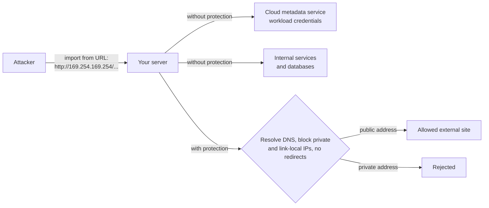

### 🔍 Worked example
TaskFlow's "import from URL" fetched any URL. A tester submits a URL resolving to the cloud
metadata service and retrieves the instance's credentials. Fixes: an egress allow-list for the
import feature; reject private/link-local addresses after DNS resolution; no redirects; size and
time limits; run the fetcher with an identity that has no useful permissions; and use metadata
endpoints that require a special header.

### ✅ Best practices
- ✅ Threat-model at design time; revisit for new trust boundaries.
- ✅ Defence in depth: app checks + database policies + network controls + least privilege.
- ✅ Secrets eliminated or managed; rotated; never logged.
- ✅ Supply-chain hygiene in CI.
- ❌ Don't fetch user-supplied URLs without SSRF protection.
- ❌ Don't bind request bodies straight onto models.

### ⚠️ Pitfalls
- Internal services without authentication ("they're behind the firewall").
- CI tokens with broad write access to the whole organization.

### 🧠 Check yourself
1. Why must SSRF checks happen after DNS resolution?
2. What is mass assignment and how do you prevent it?

<details><summary>Answers</summary>

1. A public-looking hostname can resolve to an internal address (and DNS can change between check and use); validate the resolved IP and pin it for the request.
2. Accepting arbitrary fields from a request into a model (e.g. setting `role: admin`); prevent with explicit per-role allow-lists of writable fields.
</details>

### 🛠️ Lab
Threat-model one feature with STRIDE, then fix the top three risks and add tests that prove each fix.

### 🔗 Go deeper
[SSRF](concepts/ssrf.md) · [Authorization models](concepts/authorization-models.md) · [JWTs and token verification](concepts/jwt-and-token-verification.md)

### 📌 Remember
- Threat-model; defence in depth.
- Access control, injection, SSRF, mass assignment.
- No secrets where identity will do; secure the supply chain.

---

# Part V — Cloud

---

## Chapter 15 · Cloud identity and IAM in depth

### 🎯 Outcomes
- Design least-privilege IAM for humans, services and pipelines
- Eliminate long-lived credentials with workload identity
- Structure accounts/projects and guardrails for an organization

### 🔁 Intuition check
Cloud permissions feel like admin settings. In reality every resource, service and pipeline has an
identity, and a single over-broad grant can expose everything.

### 📖 Core ideas

**Shared responsibility.** The provider secures the cloud; you secure your identities,
configuration, network rules, data and code. Most incidents are customer misconfigurations.

**Resource hierarchy and guardrails.** Organization → folders/OUs → accounts/projects. Use
separate accounts/projects per environment and per blast-radius boundary. Apply organization
policies / SCPs as guardrails (e.g. no public IPs on databases, no public buckets, allowed
regions only) so mistakes are prevented rather than detected.

**Principals.** Humans (via SSO groups), service accounts / roles for workloads, and federated
identities (CI systems, other clouds, workforce identity pools).

**Least privilege in practice**
- Grant **predefined or custom roles** with only the needed permissions, on the **narrowest resource** (one service, one bucket, one secret), not the whole project.
- **Separate identities per workload and per purpose:** build vs runtime; one runtime identity per service.
- Let build identities *act as* runtime identities for deployment only, rather than holding the runtime's permissions.
- Use **conditions** (time-bound, resource-name-bound) for elevated access; prefer just-in-time access for humans.
- Review unused permissions with provider recommenders/access analyzers.

**No long-lived keys.**
- Workloads: platform metadata credentials, short-lived tokens.
- CI/CD: **OIDC federation** (GitHub Actions → AWS IAM OIDC provider / GCP Workload Identity Federation / Azure workload identity federation), restricted to specific repositories and branches.
- Databases: IAM-based authentication where available.
- If a key file exists, treat it as an incident waiting to happen.

**Service-to-service authorization.** Make internal services private and grant callers an explicit
"invoke" permission. Combined with verified identity tokens, that replaces shared API keys.

### ☁️ GCP ↔ AWS: identity and access

| Concept | Google Cloud | AWS |
|---|---|---|
| Top of the hierarchy | Organization → Folders → **Projects** | Organization → OUs → **Accounts** |
| Org-wide guardrails | Organization Policy constraints | Service Control Policies (SCPs) and Resource Control Policies (RCPs) |
| Human sign-in (SSO) | Cloud Identity / Google Workspace, Workforce Identity Federation | IAM Identity Center |
| Workload identity | A **service account** attached to the resource (Cloud Run service, VM, GKE via Workload Identity) | An **IAM role** assumed by the resource (EC2 instance profile, ECS task role, Lambda execution role, EKS Pod Identity / IRSA) |
| Permission bundles | Predefined and custom roles | AWS-managed and customer-managed policies |
| Where permissions are granted | Allow policies bound **on resources** (project, bucket, service…) | **Identity-based** policies on roles/users plus **resource-based** policies (bucket, queue, key) |
| Explicit deny | IAM deny policies | `Deny` statements (always win) |
| Letting a deployer launch something as another identity | `iam.serviceAccountUser` (actAs) on the runtime service account | `iam:PassRole` on the runtime role |
| Keyless CI/CD | Workload Identity Federation (OIDC from GitHub, GitLab…) | IAM OIDC identity provider + `AssumeRoleWithWebIdentity` |
| Private service called only by one caller | Grant `roles/run.invoker` on the Cloud Run service to the caller's service account | IAM auth on Lambda function URLs, API Gateway IAM authorization, or VPC Lattice auth policies |
| Finding over-broad access | IAM Recommender, Policy Analyzer | IAM Access Analyzer |
| Secrets | Secret Manager | Secrets Manager / SSM Parameter Store |

**Watch out when moving between them**
- On **GCP**, you grant *a principal a role on a resource*. On **AWS**, permission is the
  combination of identity policies, resource policies, SCPs/RCPs, permission boundaries and session
  policies — and **any explicit deny wins**. Debug AWS access with the policy simulator and
  Access Analyzer; debug GCP access with Policy Troubleshooter.
- A GCP **project** and an AWS **account** play the same role: the unit of isolation and billing.
  Use one per environment on either cloud.
- "Service account" on GCP ≈ "IAM role assumed by a workload" on AWS. Long-lived keys exist on both
  (service account keys, IAM user access keys) — avoid both.

### 🗺️ Picture it

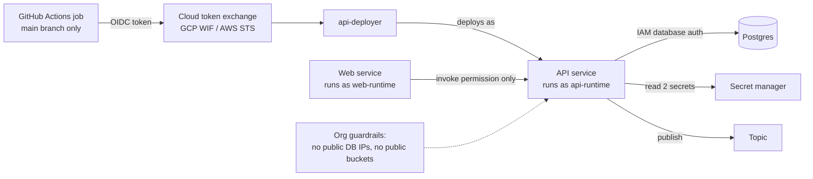

### 🔍 Worked example
TaskFlow's IAM design (names written cloud-neutrally — on GCP each is a service account, on AWS an IAM role):
- `taskflow-api-build`: may push images to one registry and deploy one service; may act as the runtime identity.
- `taskflow-api-runtime`: may connect to its database (IAM auth), read two secrets, publish to one topic.
- `taskflow-web-runtime`: may **invoke** the private API service — nothing else.
- GitHub Actions federates via OIDC, restricted to `refs/heads/main` of the TaskFlow repo.
- Org policies forbid public IPs on databases and public buckets.
A compromised web container can call the API as itself, but can't deploy, read the database or
touch other projects.

### ✅ Best practices
- ✅ Environments and blast radii in separate accounts/projects; org-level guardrails.
- ✅ Least privilege on the narrowest resource; one identity per workload and purpose.
- ✅ Federated, short-lived credentials for CI and workloads.
- ✅ Private services with explicit invoke grants.
- ✅ Regular access reviews and permission right-sizing.
- ❌ No owner/editor roles for workloads or pipelines.
- ❌ No downloaded service account keys.

### ⚠️ Pitfalls
- One shared service account used by every service.
- OIDC trust policies that accept any repository or branch.

### 🧠 Check yourself
1. Why should a build identity *act as* the runtime identity instead of holding its permissions?
2. How should a CI OIDC trust be scoped?

<details><summary>Answers</summary>

1. The build identity can launch the service with the runtime's permissions without itself being able to read data or call APIs; compromise of either is contained.
2. To the specific repository, and ideally specific branches/environments, with the minimal roles needed for that pipeline.
</details>

### 🛠️ Lab
Set up OIDC federation from GitHub Actions to your cloud, scoped to one repo and branch, and deploy
a service with separate build and runtime identities.

### 🔗 Go deeper
[Least privilege in cloud IAM](concepts/least-privilege-iam.md) · [Workload identity and keyless CI/CD](concepts/workload-identity-federation.md)

### 📌 Remember
- Guardrails at the org level; separate projects per environment.
- Least privilege, narrow scope, separate identities.
- Federated, short-lived credentials — no keys.

---

## Chapter 16 · Compute, containers and networking

### 🎯 Outcomes
- Pick the right compute platform and tune it
- Build secure, efficient container images
- Design private networking for services and data

### 🔁 Intuition check
Managed hosting platforms hide these choices. Running your own services means choosing the platform,
the network paths and the trade-offs between cost, latency and control.

### 📖 Core ideas

**Choosing compute**

| Platform | Choose when |
|---|---|
| Serverless containers (Cloud Run, App Runner/Fargate, Container Apps) | Default for HTTP services and workers |
| Kubernetes (GKE, EKS, AKS) | Many services, custom networking/scheduling, a platform team |
| Functions | Small event handlers and glue |
| VMs | Specialized workloads, legacy, licensing, GPUs with special needs |

**Tuning serverless containers**
- **Concurrency per instance:** high for I/O-bound Node services; lower for CPU-bound work.
- **Min instances** to avoid cold starts on latency-sensitive paths; **max instances** to protect downstream databases.
- **CPU allocation:** request-only vs always-on affects background work and cost.
- **Revisions and traffic splitting** for canaries, tagged preview URLs and instant rollback.
- **Startup and liveness probes;** graceful shutdown.

**Kubernetes concepts worth knowing even if you don't run it:** Pods, Deployments, Services,
Ingress/Gateway, ConfigMaps/Secrets, requests/limits, HPA, readiness vs liveness probes,
PodDisruptionBudgets, namespaces and network policies.

**Container images**
- Multi-stage builds; minimal bases (slim/distroless); non-root user; read-only filesystem where possible.
- Deterministic builds (lockfiles, pinned base digests); layer ordering for caching.
- Scan images; sign them; deploy by digest, not mutable tags.

**Networking**
- **VPC design:** private subnets for services and data; public entry only at load balancers or managed edges.
- **Private access to managed services** (private IP, Private Service Connect / PrivateLink / Private Endpoints).
- **Egress control:** NAT with known IPs, egress firewalls or proxies for outbound allow-lists.
- **Edge:** global load balancers, TLS termination, WAF, CDN, and identity-aware proxies to put authentication in front of apps.
- **Admin access** via identity-aware tunnels or bastions, never public SSH.
- **Zero trust:** authenticate and authorize every hop; the network is not a security boundary on its own.
- **DNS and service discovery;** health checks at every layer.

### ☁️ GCP ↔ AWS: compute

| Need | Google Cloud | AWS |
|---|---|---|
| Serverless containers (the default) | Cloud Run (services, jobs, worker pools) | App Runner, or ECS on Fargate |
| Functions | Cloud Run functions | Lambda |
| Kubernetes | GKE (Standard or Autopilot) | EKS (with Fargate or Auto Mode) |
| Virtual machines | Compute Engine | EC2 |
| Container registry | Artifact Registry | ECR |
| Revisions / traffic splitting | Cloud Run revisions with traffic splits and tagged URLs | Lambda aliases with weighted routing; ECS blue/green deployments; App Runner deployments |
| Scale-to-zero | Cloud Run (default) | Lambda (always); App Runner can pause; Fargate services don't scale to zero by default |
| Batch / background jobs | Cloud Run jobs, Batch | AWS Batch, ECS scheduled tasks |

### ☁️ GCP ↔ AWS: networking

| Need | Google Cloud | AWS |
|---|---|---|
| Private network | VPC — **global**, with regional subnets | VPC — **regional**, with subnets per Availability Zone |
| Serverless reaching the VPC | Direct VPC egress (or Serverless VPC Access connector) | Lambda / ECS tasks attached to VPC subnets (ENIs) |
| Private access to Google/AWS managed services | Private Google Access, private services access, Private Service Connect | VPC endpoints (gateway and interface / PrivateLink) |
| Outbound internet from private resources | Cloud NAT | NAT Gateway |
| Firewalls | VPC firewall rules / firewall policies | Security groups (stateful, per resource) and network ACLs |
| Load balancing | Cloud Load Balancing (global external Application LB, regional LBs) | Application Load Balancer, Network Load Balancer, Global Accelerator |
| WAF | Cloud Armor | AWS WAF |
| Authentication in front of apps | Identity-Aware Proxy (IAP) | AWS Verified Access, or ALB with OIDC/Cognito authentication |
| Admin access to private hosts/databases | IAP TCP forwarding (to a bastion) | SSM Session Manager (port forwarding) |
| DNS | Cloud DNS | Route 53 |
| Connecting VPCs | VPC Network Peering, Network Connectivity Center | VPC peering, Transit Gateway |

**Watch out when moving between them**
- A GCP VPC spans **all regions**; an AWS VPC lives in **one region**. Multi-region on AWS means
  multiple VPCs connected together.
- AWS **security groups** attach to resources and reference each other; GCP **firewall rules**
  target instances by network tags or service accounts.
- On AWS, high availability means spreading subnets across **Availability Zones** yourself; many
  GCP serverless services are regional by default.

### 🗺️ Picture it

**On Google Cloud**

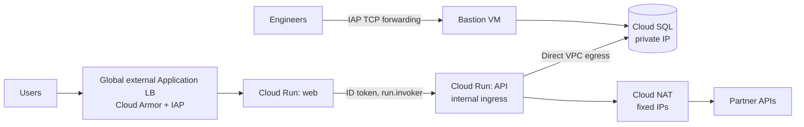

**On AWS**

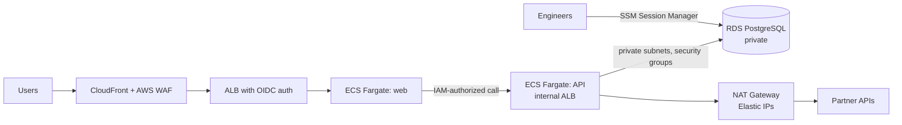

### 🔍 Worked example
TaskFlow's architecture: users hit a global load balancer with WAF and an identity-aware proxy; the
web app (serverless container) calls the private API service using its own identity token; the API
reaches Postgres over private IP via VPC egress; outbound calls to third parties go through NAT with
fixed IPs that partners allow-list; engineers inspect the database through an identity-aware tunnel
to a bastion. No database or internal service has a public address.

The same design on each cloud:

| Piece | Google Cloud | AWS |
|---|---|---|
| Edge, WAF, sign-in | Global external Application Load Balancer + Cloud Armor + IAP | CloudFront + AWS WAF + ALB with OIDC (or Verified Access) |
| Web app | Cloud Run service | App Runner or ECS Fargate service |
| Private API | Cloud Run service, ingress internal, `run.invoker` granted to the web app's service account | ECS Fargate service on an internal ALB, or a Lambda function URL with IAM auth |
| Database | Cloud SQL (private IP), IAM database auth | RDS PostgreSQL in private subnets, IAM database auth |
| API → database path | Direct VPC egress | ECS tasks in private subnets with security group rules |
| Outbound with fixed IPs | Cloud NAT with reserved IPs | NAT Gateway with Elastic IPs |
| Admin access | IAP TCP forwarding to a bastion VM | SSM Session Manager port forwarding |

### ✅ Best practices
- ✅ Serverless containers by default; Kubernetes with a reason.
- ✅ Tune concurrency, min/max instances and probes deliberately.
- ✅ Minimal, non-root, scanned, signed images deployed by digest.
- ✅ Private by default; controlled egress; identity-aware admin access.
- ❌ No public IPs on databases or internal services.
- ❌ Don't let autoscaling max instances overwhelm your database.

### ⚠️ Pitfalls
- Max instances × pool size exceeding database connections during a spike.
- Mutable `latest` tags making rollbacks deploy something unexpected.

### 🧠 Check yourself
1. Why cap max instances on an autoscaling API?
2. Readiness vs liveness probe — what's the difference?

<details><summary>Answers</summary>

1. To protect downstream dependencies (especially database connections) from being overwhelmed by unbounded scale-out.
2. Readiness controls whether an instance receives traffic; liveness controls whether it should be restarted.
</details>

### 🛠️ Lab
Deploy a service privately with a database on private IP, controlled egress, a canary revision at
10% traffic and a rollback.

### 🔗 Go deeper
[Connection pooling](concepts/connection-pooling.md) · [Least privilege in cloud IAM](concepts/least-privilege-iam.md)

### 📌 Remember
- Pick compute by need; tune it.
- Secure, minimal, signed images by digest.
- Private networking, controlled egress, zero trust.

---

## Chapter 17 · Infrastructure as Code and delivery

### 🎯 Outcomes
- Structure Terraform for multiple environments and teams
- Build pipelines that deploy safely, progressively and keylessly
- Coordinate application, schema and infrastructure changes

### 🔁 Intuition check
Clicking through a console feels faster. Code-defined infrastructure and automated delivery are what
make changes reviewable, repeatable and reversible.

### 📖 Core ideas

**IaC with Terraform/OpenTofu**
- **State:** remote, locked, encrypted, separate per environment (or per component). Never hand-edit.
- **Modules:** versioned, small, composable; avoid "mega-modules".
- **Plan in PRs, apply on merge,** with the plan output reviewed.
- **Drift detection:** scheduled plans that alert when reality diverges from code.
- **Policy as code:** OPA/Conftest, Sentinel or provider policy tools to block risky changes (public buckets, wildcard IAM).
- **Ownership boundaries:** decide what IaC owns vs what CI changes. A common split: IaC owns service *configuration*; CI only updates the *image*, with IaC ignoring image changes.

**Delivery pipelines**
```
PR: lint → typecheck → unit → build image → integration (real DB) → contract tests → security scans → preview environment
main: sign + push by digest → migrate (expand) → deploy canary → smoke + SLO checks → progressive rollout → (later) contract migrations
```
- **Build once, promote the same artifact** across environments.
- **Keyless CI auth** via OIDC federation.
- **Progressive delivery:** canary/blue-green with automated rollback on SLO regression.
- **Feature flags** decouple deploy from release; clean them up.
- **Migrations:** backward compatible, applied before code, with lock timeouts (Chapter 8).
- **Monorepos:** path-filtered pipelines so changing one app doesn't deploy others.

### ☁️ GCP ↔ AWS: infrastructure as code and delivery

| Need | Google Cloud | AWS |
|---|---|---|
| Cross-cloud IaC | Terraform / OpenTofu (`google` provider) | Terraform / OpenTofu (`aws` provider) |
| Native IaC | Infrastructure Manager (runs Terraform) | CloudFormation, AWS CDK |
| Terraform remote state | Cloud Storage bucket (built-in locking) | S3 bucket (native S3 locking in Terraform 1.10+, or DynamoDB lock table) |
| Managed CI/CD | Cloud Build, Cloud Deploy | CodeBuild, CodePipeline, CodeDeploy |
| GitHub Actions → cloud, no keys | `google-github-actions/auth` with Workload Identity Federation | `aws-actions/configure-aws-credentials` with an IAM OIDC provider |
| Progressive delivery | Cloud Run traffic splitting; Cloud Deploy canary | CodeDeploy canary/linear for Lambda and ECS; Lambda weighted aliases |
| Policy as code | Organization Policy, custom constraints; OPA/Conftest on plans | SCPs, AWS Config rules, CloudFormation Guard; OPA/Conftest on plans |
| Drift detection | Scheduled `terraform plan` | Scheduled `terraform plan`; CloudFormation drift detection |

### 🗺️ Picture it

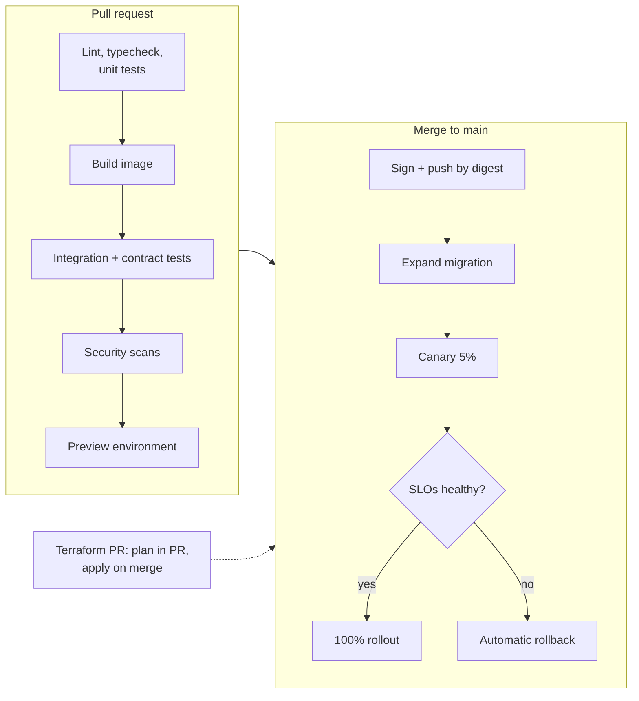

### 🔍 Worked example
Shipping TaskFlow's assignee change (Chapter 8) end to end: a Terraform PR adds the new topic and
IAM grant (plan reviewed, applied on merge); the app PR's pipeline runs the expand migration,
deploys a canary at 5% with automated SLO checks, then 100%; a feature flag enables the new
behaviour per org; two releases later, the contract migration drops the old column.

### ✅ Best practices
- ✅ Remote, locked state; small versioned modules; drift detection; policy as code.
- ✅ Clear ownership between IaC and CI.
- ✅ Build once, sign, deploy by digest; keyless CI.
- ✅ Canary with automated rollback; feature flags for release control.
- ❌ No manual console changes to IaC-managed resources.
- ❌ No pipelines that deploy without automated verification.

### ⚠️ Pitfalls
- Terraform and CI both managing the same setting and fighting each other.
- One giant state file where any change risks everything.

### 🧠 Check yourself
1. What problem does drift detection solve?
2. Why decouple deploy and release with feature flags?

<details><summary>Answers</summary>

1. It reveals manual or out-of-band changes before they cause surprises (or get silently reverted) on the next apply.
2. Code can ship safely dark, be enabled gradually or per tenant, and be turned off instantly without a redeploy.
</details>

### 🛠️ Lab
Build a pipeline with a PR preview environment, keyless deploy, canary with automated rollback on
error rate, and a Terraform repo with policy checks.

### 🔗 Go deeper
[Workload identity and keyless CI/CD](concepts/workload-identity-federation.md) · [Zero-downtime migrations](concepts/zero-downtime-migrations.md)

### 📌 Remember
- State, modules, plan-in-PR, drift, policy as code.
- Build once; keyless; progressive delivery; flags.
- Coordinate schema, app and infra changes.

---

# Part VI — Senior practice

---

## Chapter 18 · System design

### 🎯 Outcomes
- Run a structured design from requirements to trade-offs
- Estimate capacity and cost credibly
- Write design docs that get good decisions made

### 📖 Core ideas

**The method**
1. **Requirements:** functional, and non-functional (latency, availability, consistency, durability, scale, cost, compliance, data residency).
2. **Estimates:** traffic (average and peak), data volume and growth, read/write ratio.
3. **API and events:** contracts first.
4. **Data model and storage:** by access pattern; consistency needs per entity.
5. **High-level architecture:** edges, services, storage, async paths, third parties.
6. **Deep dives:** the hard parts — hot keys, ordering, idempotency, failure modes, security boundaries.
7. **Scale and reliability:** caching, partitioning, replication, SLOs, observability, DR (RPO/RTO).
8. **Trade-offs and alternatives:** what you rejected and why; what you'd revisit at 10×.

**Design docs** that work: context and goals, non-goals, proposal, alternatives, risks, rollout and
migration plan, observability, cost, open questions. Short beats exhaustive. Decisions recorded as
**ADRs** so future readers know *why*.

### 🗺️ Picture it

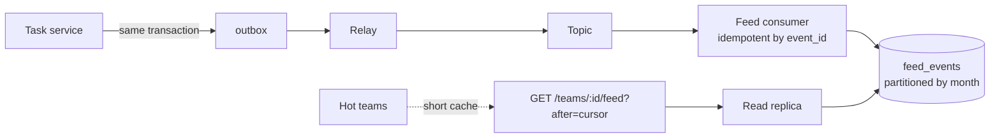

### 🔍 Worked example — TaskFlow activity feed
- *Requirements:* per-team feed of events, newest first, < 200 ms p95, eventual consistency OK (seconds), 2-year retention.
- *Estimates:* 5M events/day ≈ 60/s average, 600/s peak; ~2 KB/event → ~3.6 TB over two years.
- *API:* `GET /v1/teams/{id}/feed?after=<cursor>` (keyset on `(created_at, id)`).
- *Data:* `feed_events` partitioned monthly; index `(team_id, created_at DESC, id DESC)`; old partitions dropped for retention.
- *Writes:* domain events via the outbox → a consumer inserts feed rows (idempotent by event id).
- *Reads:* index scan per team; hot teams get a short cache; read replica for feed queries.
- *Failure:* consumer lag alerts; replay from the outbox; feed degrades to "updating…".
- *Trade-off:* fan-out on read (query per team) instead of per-user materialized feeds — simpler and cheaper at this scale; revisit at 10×.

### ✅ Best practices
- ✅ Start from requirements and numbers.
- ✅ Contracts and data model before boxes and arrows.
- ✅ Explicit failure modes, SLOs and rollout plans.
- ✅ Write down trade-offs and ADRs.
- ❌ Don't choose technology before understanding access patterns.

### 🧠 Check yourself
1. 5M events/day at a 10× peak factor — what peak write rate do you design for?
2. What belongs in a design doc's "non-goals" and why?

<details><summary>Answers</summary>

1. ~58/s average → ~580/s peak; round up to ~600/s plus headroom.
2. Things deliberately out of scope, to prevent scope creep and focus review on what matters.
</details>

### 🛠️ Lab
Write a two-page design doc for: a rate limiter, a webhook delivery system, or a multi-tenant file
storage service. Get it reviewed.

### 🔗 Go deeper
[CAP and PACELC](concepts/cap-and-pacelc.md) · [Outbox pattern](concepts/outbox-pattern.md) · [Keyset pagination](concepts/keyset-pagination.md) · [SLOs, error budgets and burn rate](concepts/slos-error-budgets-burn-rate.md)

### 📌 Remember
- Requirements → estimates → contracts → data → architecture → deep dives → reliability → trade-offs.
- Short design docs; ADRs for decisions.

---

## Chapter 19 · Technical leadership

### 🎯 Outcomes
- Make sound decisions under uncertainty and communicate them
- Review code and designs at a senior level
- Raise the effectiveness of the people around you

### 📖 Core ideas

**Judgment**
- **Reversibility drives rigour.** Move fast on reversible decisions; slow down for data changes, migrations, public contracts, security boundaries and deletions.
- **One source of truth** for every rule; consistency beats local cleverness.
- **Simple first;** add complexity when evidence demands it.
- **Own outcomes,** not tickets: production health, cost and developer experience included.

**Reviewing**
- Priority: correctness → security/authorization → data integrity and concurrency → contracts and compatibility → performance → tests → readability.
- Ask: *no data? concurrent requests? retries? malicious caller? 100× data? partial failure?*
- **Verify findings before posting** — reproduce them; automated and AI-generated findings are often wrong.
- Write comments a newcomer understands: what you saw, why it matters, a suggestion; label blocking vs non-blocking; ask when intent is unclear.

**Working with others**
- Small PRs with context, verification steps and risks.
- **Stacked PRs** for dependent work; retarget after the base merges.
- Estimates as ranges with named unknowns.
- Incidents: stabilize, communicate on a cadence, then blameless postmortems with owned actions.
- Mentoring through pairing, design reviews and explaining the *why*.
- Bridge teams that share an API: shared contracts, mocks, both sides changed together.

### 🗺️ Picture it

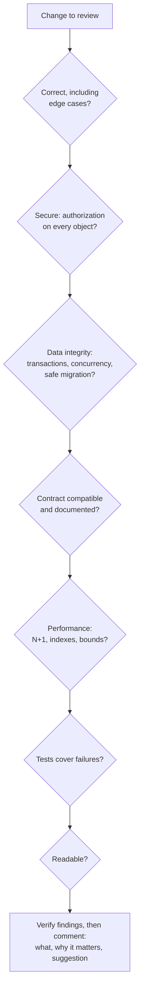

### 🔍 Worked example
An automated review flags five issues on a teammate's PR. Before commenting, you reproduce each
locally: one is a false positive (dropped), two are confirmed (posted as blocking, with exact steps
to reproduce), two are design questions (posted as non-blocking questions). The PR gets fixed in
one round instead of three, and nobody wastes time on a non-issue.

### ✅ Best practices
- ✅ Rigour proportional to irreversibility.
- ✅ Verified, plain-language reviews with clear severity.
- ✅ Decisions and context written down.
- ✅ Make others better: pairing, docs, examples.
- ❌ Don't gold-plate or expand scope silently.
- ❌ Don't let knowledge live only in your head.

### 🧠 Check yourself
1. List five changes that deserve extra rigour because they're hard to reverse.
2. What makes a review comment effective?

<details><summary>Answers</summary>

1. Data migrations/deletions, public API changes, security boundaries/IAM changes, infrastructure deletions, schema changes on large tables.
2. It's verified, specific (what and where), explains impact, suggests a fix, states severity, and is written so anyone on the team can understand it.
</details>

### 🛠️ Lab
Pick a merged PR from your team and write the review you'd give it now using the checklist. Then
write an ADR for a decision your team made without one.

### 📌 Remember
- Judgment scales with reversibility.
- Verified, plain, prioritized reviews.
- Write it down; raise the team.

---

# Appendices

---

## Appendix A · Principles at a glance

**Services**
1. Event loop lag is a first-class health metric; stream, pool, time out.
2. Graceful shutdown; crash on unknown state.
3. Contract-first APIs; scope by identity.
4. Idempotency keys for side effects; ETags for concurrent edits; keyset pagination with tie-breakers.
5. Evolve additively; deprecate visibly.

**Identity**
6. Verify tokens fully; keep them short-lived.
7. Workload identity between services; trust forwarded identity only from verified callers.
8. Centralize authorization; enforce tenant isolation in the data layer.

**Architecture**
9. One-way dependencies; rules in the core; I/O at the edges.
10. Modular monolith first; one source of truth per rule.

**Data**
11. Understand MVCC: keep transactions short; watch bloat and long transactions.
12. Pool connections within database limits.
13. Index for access patterns; measure with `pg_stat_statements` and `EXPLAIN`.
14. Constraints → atomic statements → optimistic → pessimistic → serializable.
15. `lock_timeout` on migrations; expand → migrate → contract.
16. Postgres first; feed other stores from the source of truth; cache with a staleness budget.

**Distributed systems**
17. At-least-once delivery; idempotent consumers; outbox for publishing.
18. Timeouts, deadlines, safe retries with budgets, breakers, bulkheads, load shedding.
19. Choose consistency per operation; provide read-your-writes.

**Operations**
20. Real infrastructure in tests; test authorization, concurrency and migrations.
21. OpenTelemetry; RED/USE; SLOs with burn-rate alerts; mitigate first.
22. Threat-model; defence in depth; no secrets where identity will do; secure the supply chain.

**Cloud**
23. Org guardrails; separate projects per environment; least privilege on narrow scopes.
24. Federated, short-lived credentials; no keys.
25. Serverless containers by default, tuned; private networking; zero trust.
26. Infrastructure as code with policy and drift detection; build once; progressive delivery.

**Leadership**
27. Rigour proportional to irreversibility.
28. Verify before you claim; write so a newcomer understands.
29. Record decisions; raise the people around you.

---

## Appendix B · 12-week study plan

Build TaskFlow's backend as you go.

| Week | Chapters | Build |
|---|---|---|
| 1 | 1 | Service with event-loop and heap metrics, graceful shutdown, `AsyncLocalStorage` request context |
| 2 | 2 | Contract-first API with idempotency keys, ETags and keyset pagination |
| 3 | 3–4 | IdP login, centralized authorization, multi-tenant RLS; layered modules with an architecture test |
| 4 | 5–6 | Load 10M rows; `pg_stat_statements`; index design; PgBouncer in transaction mode |
| 5 | 7 | Reproduce and fix write skew; `SKIP LOCKED` job queue |
| 6 | 8 | Zero-downtime column split under load |
| 7 | 9–10 | Redis cache-aside with stampede protection; outbox + idempotent consumers |
| 8 | 11 | Fault injection; timeouts, breakers, bulkheads, retry budgets |
| 9 | 12–13 | Concurrency and authz test matrix; OpenTelemetry; SLO with burn-rate alerts |
| 10 | 14 | STRIDE threat model; fix SSRF/mass-assignment risks; supply-chain checks in CI |
| 11 | 15–16 | Cloud deploy on **GCP, then repeat on AWS**: OIDC CI, build/runtime identities, private DB, controlled egress, canary. Use the ☁️ tables to map each step |
| 12 | 17–19 | Terraform with policy checks and drift detection; design doc and ADRs for 10× scale |

**Certifications worth the time:**
- **Google Cloud:** Associate Cloud Engineer, then Professional Cloud Architect (or Professional Cloud Developer).
- **AWS:** Solutions Architect – Associate, then Developer – Associate or Solutions Architect – Professional.
- **Both:** HashiCorp Terraform Associate.

---

## Appendix C · GCP ↔ AWS map (plus Azure)

| Need | Google Cloud | AWS | Azure |
|---|---|---|---|
| Unit of isolation and billing | Project | Account | Subscription |
| Org guardrails | Organization Policy | SCPs / RCPs | Azure Policy |
| Human SSO | Cloud Identity / Workforce Identity Federation | IAM Identity Center | Entra ID |
| Workload identity | Service account | IAM role | Managed identity |
| Keyless CI auth | Workload Identity Federation | IAM OIDC provider | Workload identity federation |
| Serverless containers | Cloud Run | App Runner / ECS on Fargate | Container Apps |
| Functions | Cloud Run functions | Lambda | Azure Functions |
| Kubernetes | GKE | EKS | AKS |
| Virtual machines | Compute Engine | EC2 | Virtual Machines |
| Managed Postgres | Cloud SQL / AlloyDB | RDS / Aurora | Azure Database for PostgreSQL |
| Connection pooling | Managed pooling (supported editions) / PgBouncer | RDS Proxy | Built-in PgBouncer (Flexible Server) |
| NoSQL | Firestore / Bigtable | DynamoDB | Cosmos DB |
| Cache | Memorystore | ElastiCache / MemoryDB | Azure Cache for Redis |
| Object storage | Cloud Storage | S3 | Blob Storage |
| Warehouse | BigQuery | Redshift / Athena | Synapse / Fabric |
| Pub/sub and queues | Pub/Sub / Cloud Tasks | SNS / SQS | Service Bus / Event Grid |
| Event routing | Eventarc | EventBridge | Event Grid |
| Workflow orchestration | Workflows | Step Functions | Logic Apps / Durable Functions |
| Scheduler | Cloud Scheduler | EventBridge Scheduler | Logic Apps / Functions timer |
| Registry | Artifact Registry | ECR | Container Registry |
| Secrets | Secret Manager | Secrets Manager / SSM Parameter Store | Key Vault |
| Identity-aware access to apps | Identity-Aware Proxy | Verified Access / ALB OIDC | Entra application proxy |
| Private access to managed services | Private Service Connect / private services access | PrivateLink / VPC endpoints | Private Endpoint |
| NAT | Cloud NAT | NAT Gateway | NAT Gateway |
| Load balancing | Cloud Load Balancing | ALB / NLB | Application Gateway / Load Balancer |
| WAF and CDN | Cloud Armor / Cloud CDN | AWS WAF / CloudFront | Front Door + WAF |
| Bastion-free admin access | IAP TCP forwarding | SSM Session Manager | Azure Bastion |
| DNS | Cloud DNS | Route 53 | Azure DNS |
| Logs, metrics, traces | Cloud Logging / Monitoring / Trace | CloudWatch / X-Ray | Azure Monitor / Application Insights |
| Audit logs | Cloud Audit Logs | CloudTrail | Activity Log |
| Native IaC | Infrastructure Manager | CloudFormation / CDK | Bicep |
| Managed CI/CD | Cloud Build / Cloud Deploy | CodeBuild / CodePipeline / CodeDeploy | Azure DevOps Pipelines |

---

## Appendix D · Numbers and formulas worth knowing

| Item | Value / formula |
|---|---|
| Requests per day → per second | ÷ 86,400 (1M/day ≈ 11.6/s) |
| Peak factor | Plan for 5–10× average unless you have data |
| Little's Law | concurrency = throughput × latency |
| 99.9% availability | ~43.8 min downtime/month; 99.99% ≈ 4.4 min/month |
| Burn rate 14.4× for 1 hour | Consumes 2% of a 30-day error budget |
| Retries across N layers, r retries each | Up to (r + 1)^N attempts |
| Connection budget | instances × pool size ≤ max_connections − headroom |
| libuv threadpool | 4 threads by default (`UV_THREADPOOL_SIZE`) |
| Latency, rough orders | memory ~100 ns · SSD read ~100 µs · same-region network round trip ~0.5–1 ms · cross-continent ~70–150 ms |

---

## Appendix E · Further reading

- *Designing Data-Intensive Applications* — Martin Kleppmann (essential)
- *Database Internals* — Alex Petrov
- *Release It!* — Michael Nygard (stability patterns)
- *Site Reliability Engineering* and *The Site Reliability Workbook* — Google (free online)
- *Building Microservices* — Sam Newman
- *Software Engineering at Google* — Winters, Manshreck, Wright (free online)
- *Staff Engineer* — Will Larson
- *Use The Index, Luke* — Markus Winand (free online)
- PostgreSQL documentation: concurrency control, indexes, performance tips, routine vacuuming
- OWASP Top 10, ASVS and Cheat Sheet Series
- AWS Well-Architected, Google Cloud Architecture Framework, Azure Well-Architected
- Node.js docs: event loop, worker threads, streams, diagnostics

---

## Appendix F · Deep dives: concepts and SQL

**Concepts** — [index](concepts/README.md)

| APIs & services | Data | Distributed systems | Security & cloud |
|---|---|---|---|
| [Idempotency](concepts/idempotency.md) | [MVCC and VACUUM](concepts/mvcc-and-vacuum.md) | [Outbox pattern](concepts/outbox-pattern.md) | [JWTs and verification](concepts/jwt-and-token-verification.md) |
| [Optimistic concurrency / ETags](concepts/optimistic-concurrency-etags.md) | [Isolation levels and write skew](concepts/isolation-levels-and-write-skew.md) | [Sagas](concepts/sagas.md) | [Authorization models](concepts/authorization-models.md) |
| [Keyset pagination](concepts/keyset-pagination.md) | [Indexing](concepts/indexing.md) | [Retries, backoff, jitter](concepts/retries-backoff-jitter.md) | [Row-level security](concepts/row-level-security.md) |
| [Event loop and libuv](concepts/event-loop-and-libuv.md) | [N+1 queries](concepts/n-plus-one.md) | [Circuit breakers, bulkheads, load shedding](concepts/circuit-breakers-bulkheads-load-shedding.md) | [SSRF](concepts/ssrf.md) |
| [Streams and backpressure](concepts/streams-and-backpressure.md) | [Connection pooling](concepts/connection-pooling.md) | [Little's Law](concepts/littles-law.md) | [Least privilege IAM](concepts/least-privilege-iam.md) |
| | [Zero-downtime migrations](concepts/zero-downtime-migrations.md) | [CAP and PACELC](concepts/cap-and-pacelc.md) | [Workload identity / keyless CI](concepts/workload-identity-federation.md) |
| | [Caching strategies](concepts/caching-strategies.md) | [SLOs and burn rate](concepts/slos-error-budgets-burn-rate.md) | |
| | | [Observability signals](concepts/observability-signals.md) | |

**SQL guides** — [index and practice schema](sql/README.md)

[Joins](sql/joins.md) · [Aggregation](sql/aggregation.md) · [CTEs and subqueries](sql/ctes-and-subqueries.md) · [Window functions](sql/window-functions.md) · [Upserts and RETURNING](sql/upserts-and-returning.md) · [Reading EXPLAIN ANALYZE](sql/explain-analyze.md) · [Locks and SKIP LOCKED](sql/locking-and-skip-locked.md) · [NULLs and gotchas](sql/nulls-and-gotchas.md)

---

## License

© Tariq Khan. This handbook is licensed under the
[Creative Commons Attribution 4.0 International License (CC BY 4.0)](https://creativecommons.org/licenses/by/4.0/).
You're free to share and adapt it for any purpose, as long as you give appropriate credit and
link back to this repository. See [LICENSE](LICENSE) for the full text.
