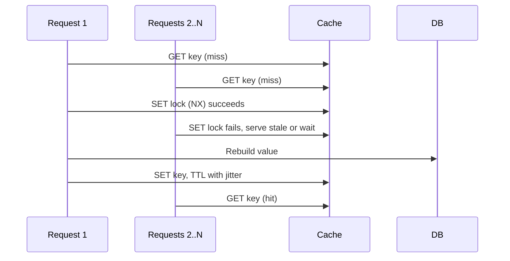

# Caching strategies, invalidation and stampedes

> A cache trades **freshness for speed**. Decide how stale is acceptable, how entries get
> invalidated, and what happens when a hot entry expires.

[← Handbook](../README.md) · [All concepts](README.md)

---

## Strategies

| Strategy | How | Trade-off |
|---|---|---|
| **Cache-aside** (lazy loading) | Read cache → on miss, load from DB → store in cache | Simple and common; first request after expiry is slow |
| **Read-through** | The cache library loads on miss | Same as cache-aside, hidden behind the cache |
| **Write-through** | Write to cache and DB together | Fresher reads; slower writes |
| **Write-behind** | Write to cache, flush to DB later | Fast writes; risk of data loss |
| **Stale-while-revalidate** | Serve the stale value, refresh in the background | Fast always; briefly stale |

## Freshness: decide it first

Every cached thing needs a **staleness budget** agreed with product: "the leaderboard can be 60
seconds old", "permissions must be fresh". Data that must be fresh shouldn't be cached — fix the
query instead.

## Invalidation

1. **TTL** — entries expire after a time. Simplest; bounds staleness.
2. **Delete on write** — after the transaction **commits**, delete the affected keys.
3. **Versioned keys** — include a version in the key (`stats:v3:user:42`); bump the version to
   invalidate everything at once (e.g. on a deploy that changes the shape).

**Invalidate after commit, not before.** If you delete the key and then commit, a concurrent read
can reload the *old* value between the two and cache it again.

## Stampedes (thundering herd)

A hot key expires and hundreds of requests miss at once and all hit the database.

- **Single-flight / request coalescing:** one request rebuilds; others wait for it or serve stale.
  ```ts
  const lock = await redis.set(`lock:${key}`, '1', { NX: true, PX: 5000 })
  if (lock) { const value = await rebuild(); await redis.set(key, value, { PX: ttl }) }
  else      { return staleValue ?? await waitForRebuild(key) }
  ```
- **Jittered TTLs:** `ttl = base ± random` so keys don't all expire together.
- **Early refresh:** refresh shortly *before* expiry (probabilistically, for hot keys).

## Picture it: stampede protection



## Where to cache

| Layer | Use for | Watch out |
|---|---|---|
| Browser (`Cache-Control`, `ETag`) | Static assets; conditional GETs | Per-user data must be `private` |
| CDN | Public assets and public API responses | Never cache authenticated responses without correct headers |
| In-process memory | Ultra-hot, tiny, rarely changing data | Each instance has its own copy; lost on restart |
| Shared cache (Redis) | Expensive computed results shared across instances | Network hop; invalidation |
| Database (materialized views) | Heavy aggregates refreshed periodically | Refresh cost and staleness |

## Pitfalls

- Caching per-user data under a shared key — a data leak.
- Caching to hide a missing index.
- No invalidation plan, so stale data lives forever.

## Related

[CAP and PACELC](cap-and-pacelc.md) · [Indexing](indexing.md)

## Further reading

- Redis documentation on client-side and server-side caching patterns: https://redis.io/docs/
