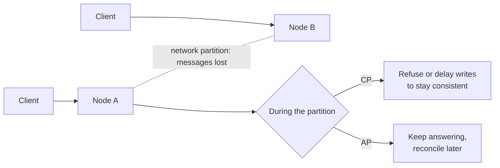

# CAP and PACELC

> In a distributed data system, when the network splits you must choose between **consistency**
> and **availability** — and even when it doesn't, you trade **latency** against consistency.

[← Handbook](../README.md) · [All concepts](README.md)

---

## CAP

- **Consistency (C):** every read sees the latest successful write (linearizability).
- **Availability (A):** every request to a working node gets a response.
- **Partition tolerance (P):** the system keeps operating when messages between nodes are lost.

Networks partition, so **P isn't optional**. CAP says: *during a partition*, choose:
- **CP** — refuse or delay some requests to stay correct (e.g. a primary that won't accept writes it can't replicate).
- **AP** — keep answering, possibly with stale or conflicting data that's reconciled later.

CAP is often misread as "pick two of three, always". It's about behaviour **during partitions**.

## Picture it

## PACELC

Daniel Abadi's extension covers the normal case too:

> **If P**artition: choose **A** or **C**. **E**lse: choose **L**atency or **C**onsistency.

Even with a healthy network, waiting for replicas to confirm a write (consistency) costs time
(latency). Examples:
- Synchronous replication across regions → consistent but slower writes.
- Reading from an asynchronous read replica → fast but possibly stale.

## What it means in day-to-day design

Choose **per operation**, not per system:

| Operation | Usually needs |
|---|---|
| Money, permissions, inventory, uniqueness | Strong consistency |
| Feeds, counters, recommendations, analytics | Eventual consistency is fine |
| A user viewing their own just-saved change | **Read-your-writes** |

**Read-your-writes** with replicas: after a user writes, route *their* reads to the primary for a
short time, or read from a replica only once it has replayed past the write's position.

## Related

[Isolation levels and write skew](isolation-levels-and-write-skew.md) · [Caching strategies](caching-strategies.md) ·
[Outbox pattern](outbox-pattern.md)

## Further reading

- Martin Kleppmann, *Designing Data-Intensive Applications*, chapters 5 and 9
- Daniel Abadi, *Consistency Tradeoffs in Modern Distributed Database System Design* (IEEE Computer, 2012)
