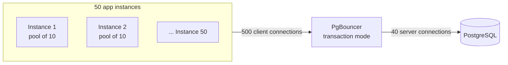

# Connection pooling

> Reuse a small number of database connections across many requests, instead of opening one per
> request.

[← Handbook](../README.md) · [All concepts](README.md)

---

## Why connections are expensive

Each PostgreSQL connection is a separate server process with its own memory. Opening one costs a
TCP handshake, TLS, authentication and process start-up. Postgres performs worse — not better —
with hundreds of active connections, and `max_connections` is a hard limit.

## Two levels of pooling

**1. In the application** — every database driver offers a pool (`pg.Pool`, Prisma's pool,
HikariCP). Each app instance keeps, say, 10 connections and hands them to requests.

**2. A pooler between apps and the database** — needed when you have many instances (autoscaling,
serverless):



## The connection budget

```
instances_max × pool_size_per_instance  ≤  max_connections − headroom (admin, migrations, replicas)
```

Autoscaling breaks naive setups: max instances 100 × pool 10 = 1,000 connections against a database
allowing 200. Either cap max instances, shrink per-instance pools, or put a pooler in front.

## PgBouncer pooling modes

| Mode | A server connection is held for… | Notes |
|---|---|---|
| Session | The whole client session | Safest, least multiplexing |
| **Transaction** | One transaction | The usual choice — big multiplexing win |
| Statement | One statement | Breaks multi-statement transactions |

**Transaction mode breaks session state**, because consecutive transactions may run on different
server connections:
- session-level `SET` (use `SET LOCAL` inside the transaction instead);
- session advisory locks (use transaction-scoped `pg_advisory_xact_lock`);
- `LISTEN/NOTIFY`;
- named prepared statements on older PgBouncer versions (newer versions can track them — check yours).

## On GCP and AWS

| | Google Cloud | AWS |
|---|---|---|
| Managed pooler | Managed connection pooling on supported Cloud SQL editions; or run PgBouncer | RDS Proxy |
| Typical self-managed setup | PgBouncer as a sidecar or small service | PgBouncer on ECS/EKS |

## Pitfalls

- Pool too large: more connections than the database can serve efficiently; latency rises.
- Pool too small: requests queue waiting for a connection (watch "wait time for connection").
- Holding a connection during slow external calls — release it as soon as the query ends.
- Leaked connections (not returned to the pool on error) — always use `try/finally` or the driver's helpers.

## Related

[MVCC and VACUUM](mvcc-and-vacuum.md) · [Little's Law](littles-law.md)

## Further reading

- PgBouncer features and pooling modes: https://www.pgbouncer.org/features.html
