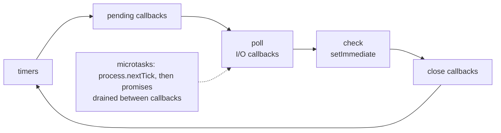

# The Node.js event loop and the libuv threadpool

> Your JavaScript runs on **one thread**. Anything synchronous and slow on that thread delays
> **every request** on the instance.

[← Handbook](../README.md) · [All concepts](README.md)

---

## The loop, briefly

Each iteration runs phases in order — **timers** (`setTimeout`), pending callbacks, **poll** (I/O
callbacks), **check** (`setImmediate`), close callbacks — and drains the **microtask queue**
(resolved promises, `queueMicrotask`) between callbacks. `process.nextTick` callbacks run even
before promise microtasks.

For a server, the one thing that matters: **while a callback runs, nothing else does.**

## Picture it



## Event loop lag — the health metric

Lag = how late the loop is in running scheduled work. Healthy services show a few milliseconds.
Spikes of hundreds of milliseconds mean something is hogging the thread.

```ts
import { monitorEventLoopDelay } from 'node:perf_hooks'

const h = monitorEventLoopDelay({ resolution: 20 })
h.enable()
setInterval(() => {
  metrics.gauge('event_loop_lag_p99_ms', h.percentile(99) / 1e6)   // nanoseconds → ms
  h.reset()
}, 10_000).unref()
```

Common culprits: `JSON.parse`/`stringify` of huge payloads, big sorts or loops, regexes with
catastrophic backtracking, synchronous crypto or compression, any `*Sync` API.

## The libuv threadpool

Network I/O (HTTP, database sockets) is handled by the OS asynchronously. But some "async" Node
APIs run on libuv's **threadpool**, which has **4 threads by default** (`UV_THREADPOOL_SIZE`, max 1024):

| Uses the threadpool | Doesn't |
|---|---|
| `fs.*` (except some watchers) | `net`, `http`, `https`, sockets |
| `dns.lookup` (used by default for hostnames) | `dns.resolve*` |
| `crypto.pbkdf2`, `scrypt`, `randomBytes` (async) | Database drivers over TCP |
| `zlib` (async) | Timers |

Four simultaneous password hashes can therefore stall file reads and DNS lookups across the
process. Raise `UV_THREADPOOL_SIZE` (set it **before** startup, via the environment) if you
legitimately need more, or move the work elsewhere.

## Handling CPU-bound work

1. Push it into the database (aggregations, filters).
2. Move it off the request path to a queue and worker.
3. Use `worker_threads` for genuinely parallel CPU work in-process.
4. Break long loops into chunks with `setImmediate` (last resort).

## Related

[Streams and backpressure](streams-and-backpressure.md) · [Observability signals](observability-signals.md) ·
[Little's Law](littles-law.md)

## Further reading

- Node.js, *The Node.js Event Loop*: https://nodejs.org/en/learn/asynchronous-work/event-loop-timers-and-nexttick
- Node.js, *Don't Block the Event Loop (or the Worker Pool)*: https://nodejs.org/en/learn/asynchronous-work/dont-block-the-event-loop
