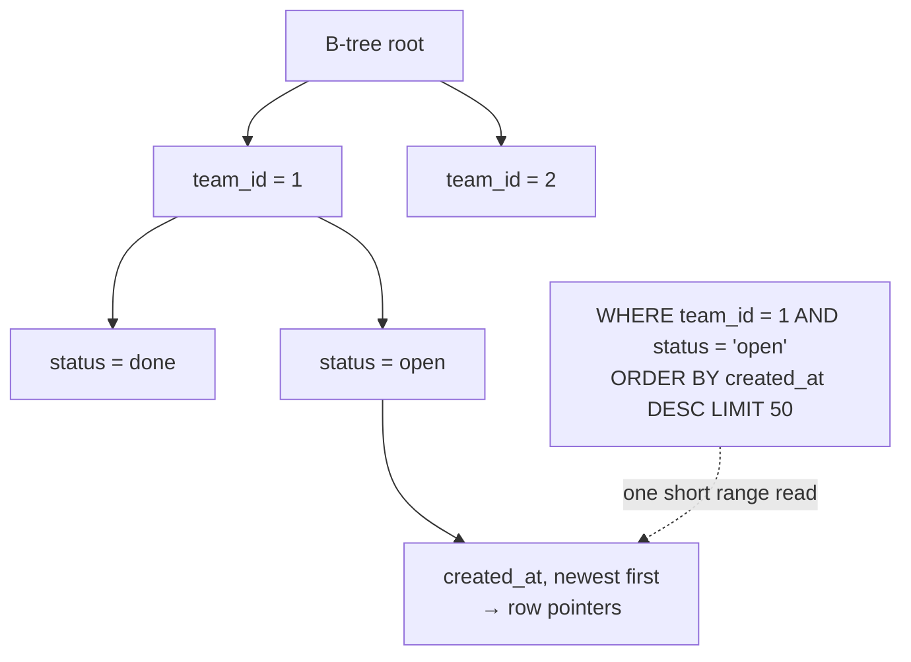

# Indexing

> An index is a separate, sorted data structure that lets the database **find rows without
> reading the whole table**.

[← Handbook](../README.md) · [All concepts](README.md)

---

## Index types (PostgreSQL)

| Type | Good for | Example |
|---|---|---|
| **B-tree** (default) | `=`, `<`, `>`, `BETWEEN`, `ORDER BY`, prefix `LIKE 'abc%'` | `CREATE INDEX ON tasks (team_id, created_at)` |
| **GIN** | `jsonb` containment (`@>`), arrays, full-text search | `CREATE INDEX ON tasks USING gin (tags)` |
| **GiST** | Ranges, geometry, nearest-neighbour, exclusion constraints | `EXCLUDE USING gist (room WITH =, during WITH &&)` |
| **BRIN** | Huge tables naturally ordered by a column (append-only logs) | `CREATE INDEX ON events USING brin (created_at)` |
| **Hash** | Equality only | rarely better than B-tree |

## Composite indexes: order matters

A B-tree on `(a, b, c)` is sorted by `a`, then `b`, then `c` — like a phone book sorted by last
name, then first name.

| Query | Uses `(team_id, status, created_at)`? |
|---|---|
| `WHERE team_id = ?` | ✅ |
| `WHERE team_id = ? AND status = ?` | ✅ |
| `WHERE team_id = ? AND status = ? ORDER BY created_at` | ✅ index order serves the sort |
| `WHERE status = ?` | ❌ not the leading column |
| `WHERE team_id = ? ORDER BY created_at` | Partly — the sort can't use it because `status` sits in between |

**Rule of thumb:** equality columns first, then the range or sort column.

### Picture it: a composite index on (team_id, status, created_at)



## Partial, covering and expression indexes

```sql
-- Partial: only the rows hot queries touch (smaller, faster)
CREATE INDEX tasks_open ON tasks (team_id, created_at DESC) WHERE status = 'open';

-- Unique among live rows only (soft delete)
CREATE UNIQUE INDEX teams_name_live ON teams (org_id, name) WHERE deleted_at IS NULL;

-- Covering: answer the query from the index alone (index-only scan)
CREATE INDEX tasks_team_cover ON tasks (team_id, created_at) INCLUDE (title, status);

-- Expression: case-insensitive lookups
CREATE INDEX users_email_lower ON users (lower(email));
-- query must match the expression: WHERE lower(email) = lower($1)
```

## Building indexes safely

On a live table use `CREATE INDEX CONCURRENTLY` — it doesn't block writes. It's slower, can't run
inside a transaction block, and leaves an `INVALID` index behind if it fails (drop it and retry).

## The cost of indexes

Every index must be updated on every insert/update of its columns, takes disk, and needs vacuum.
Find unused ones:

```sql
SELECT relname AS table, indexrelname AS index, idx_scan
FROM pg_stat_user_indexes
WHERE idx_scan = 0
ORDER BY pg_relation_size(indexrelid) DESC;
```

## Pitfalls

- Indexing every column "just in case".
- Wrapping an indexed column in a function in `WHERE` (`date(created_at) = …`) — use a range
  (`created_at >= '2026-10-01' AND created_at < '2026-10-02'`) or an expression index.
- Low-selectivity indexes (a boolean column) that the planner will ignore.
- Forgetting the foreign-key side: Postgres doesn't automatically index referencing columns.

## Related

[EXPLAIN ANALYZE](../sql/explain-analyze.md) · [N+1 queries](n-plus-one.md) ·
[Keyset pagination](keyset-pagination.md)

## Further reading

- PostgreSQL docs, *Indexes*: https://www.postgresql.org/docs/current/indexes.html
- *Use The Index, Luke*: https://use-the-index-luke.com/
