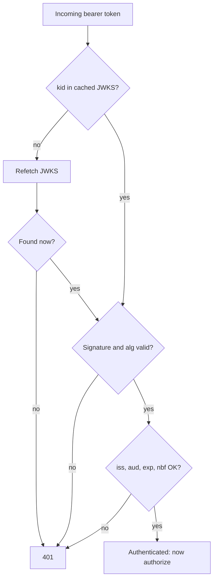

# JWTs and token verification

> A JWT is a **signed set of claims**. Anyone can read it; only the issuer can sign it. Trust it
> only after verifying **signature, issuer, audience and expiry**.

[← Handbook](../README.md) · [All concepts](README.md)

---

## Anatomy

```
eyJhbGciOiJSUzI1NiIsImtpZCI6ImFiYzEyMyJ9 . eyJpc3MiOiJodHRwczovL2lkcC5leGFtcGxlIiwic3ViIjoidV80MiIsImF1ZCI6InRhc2tmbG93LWFwaSIsImV4cCI6MTc5MDAwMDAwMH0 . <signature>
            header (base64url)                                         payload (base64url)                                                                    signature
```

```json
// header
{ "alg": "RS256", "kid": "abc123" }
// payload (claims)
{ "iss": "https://idp.example", "sub": "u_42", "aud": "taskflow-api", "exp": 1790000000, "iat": 1789996400 }
```

The payload is **encoded, not encrypted**. Never put secrets in it.

## Verifying a token — every check matters

| Check | Why |
|---|---|
| **Signature** against the issuer's public key | Proves the issuer created it and nobody changed it |
| **Algorithm** is the one you expect (e.g. `RS256`) | Blocks `alg: none` and algorithm-confusion attacks |
| **`iss`** equals your trusted issuer | Blocks tokens from other identity providers |
| **`aud`** includes *your* service | Blocks tokens minted for a different service being replayed against yours |
| **`exp`** in the future (and `nbf` in the past), with small clock skew | Expired tokens are rejected |
| Required claims present (`sub`, email verified, etc.) | Don't assume |

```ts
import { createRemoteJWKSet, jwtVerify } from 'jose'

const jwks = createRemoteJWKSet(new URL('https://idp.example/.well-known/jwks.json'))  // cached, refreshes on new kid

export async function verify(token: string) {
  const { payload } = await jwtVerify(token, jwks, {
    issuer: 'https://idp.example',
    audience: 'taskflow-api',
    algorithms: ['RS256'],
    clockTolerance: 30,
  })
  return payload
}
```

## Picture it



## Key rotation (JWKS)

Issuers publish public keys at a **JWKS** endpoint. Tokens name their key with `kid`. Cache the
key set, and refetch when you see an unknown `kid` — that's how rotation works without downtime.
Don't fetch on every request (slow) and don't cache forever (breaks on rotation).

## Token lifecycle

- **Access tokens:** short-lived (minutes). Hard to revoke, so keep them short.
- **Refresh tokens:** longer-lived, used to get new access tokens; **rotate** them on every use and
  revoke the family if an old one is reused.
- **Browser apps:** prefer a backend-for-frontend that keeps tokens server-side and gives the
  browser an `HttpOnly`, `Secure`, `SameSite` session cookie. Public clients (SPAs, mobile) use
  **PKCE** in the OAuth flow.
- **Permissions in tokens:** fine for coarse roles; anything that must change instantly (removed
  from a team) should be checked against the database.

## Service tokens

Cloud platforms issue signed identity tokens to workloads (Google ID tokens for a service account;
AWS uses signed requests/roles). Verify the same way: signature, issuer, audience = your service URL,
expiry, and that the caller identity is on your allow-list.

## Related

[Authorization models](authorization-models.md) · [Workload identity federation](workload-identity-federation.md)

## Further reading

- RFC 7519, *JSON Web Token*: https://www.rfc-editor.org/rfc/rfc7519
- RFC 8725, *JWT Best Current Practices*: https://www.rfc-editor.org/rfc/rfc8725
- RFC 7636, *PKCE*: https://www.rfc-editor.org/rfc/rfc7636
