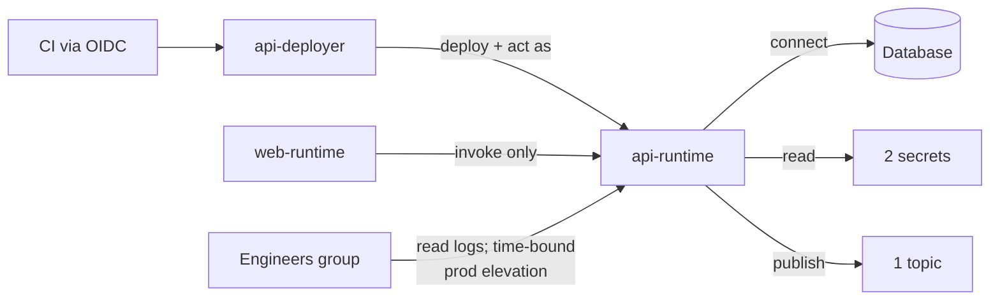

# Least privilege in cloud IAM

> Give every person and workload **only the permissions it needs, on only the resources it needs,
> for only as long as it needs them**.

[← Handbook](../README.md) · [All concepts](README.md)

---

## Why it matters

When something is compromised — a container, a CI job, a laptop — the attacker gets exactly the
permissions that identity had. Least privilege limits the **blast radius**.

## The practices

1. **One identity per workload and per purpose.** Each service has its own runtime identity; CI
   has its own deploy identity. Never share one identity across everything.
2. **Separate build from run.** The deploy identity may launch a service *as* its runtime identity,
   but doesn't hold the runtime's data permissions. A compromised app can't redeploy itself.
3. **Narrowest scope.** Grant on the specific bucket, secret, queue or service — not the whole
   project or account.
4. **Smallest role.** Prefer specific predefined roles or custom roles over broad ones
   (owner/editor, `AdministratorAccess`, `*` actions).
5. **Groups for humans,** via SSO, not individual grants. Time-bound elevation for production access.
6. **No long-lived keys** — see [workload identity federation](workload-identity-federation.md).
7. **Review regularly** with the provider's recommendations, and remove what's unused.
8. **Guardrails at the top** (organization policies / SCPs) for things that must never happen.

## GCP vs AWS: how permissions are evaluated

| | Google Cloud | AWS |
|---|---|---|
| Model | **Allow policies on resources** bind a principal to a role | **Identity-based** policies (on roles/users) + **resource-based** policies (on buckets, queues, keys) |
| Inheritance | Policies set on org/folder/project are inherited by everything below | Each account is separate; SCPs/RCPs from the organization limit the maximum |
| Explicit deny | IAM deny policies | Any `Deny` statement wins over every `Allow` |
| Extra limits | Organization Policy constraints, IAM conditions | Permission boundaries, session policies, SCPs, RCPs |
| "Launch as" permission | `iam.serviceAccountUser` on the service account | `iam:PassRole` on the role |
| Debugging access | Policy Troubleshooter, Policy Analyzer | IAM policy simulator, IAM Access Analyzer |
| Finding unused permissions | IAM Recommender | IAM Access Analyzer (unused access) |

## A worked layout

| Identity | Can |
|---|---|
| `web-runtime` | Invoke the private API service — nothing else |
| `api-runtime` | Connect to its database (IAM auth), read two secrets, publish to one topic |
| `api-deployer` (CI) | Push images to one registry, deploy one service, launch it as `api-runtime` |
| Engineers (group) | Read logs and metrics; production write access only via time-bound elevation |

## Picture it

## Pitfalls

- Granting a broad role "temporarily" and never removing it.
- Wildcards (`s3:*`, `roles/editor`) in workload policies.
- CI identities that can modify IAM itself.

## Related

[Workload identity federation](workload-identity-federation.md) · [Authorization models](authorization-models.md)

## Further reading

- Google Cloud, *IAM overview*: https://cloud.google.com/iam/docs/overview
- AWS, *Security best practices in IAM*: https://docs.aws.amazon.com/IAM/latest/UserGuide/best-practices.html
