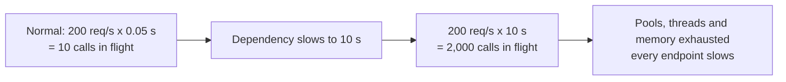

# Little's Law

> **Concurrency = throughput × latency.** The number of requests in flight equals the arrival rate
> multiplied by how long each one takes.

[← Handbook](../README.md) · [All concepts](README.md)

---

## The formula

```
L = λ × W
L = average number of requests in the system (in flight)
λ = arrival rate (requests per second)
W = average time each request spends in the system (seconds)
```

It holds for any stable system: a web server, a database, a queue, a coffee shop.

## Using it

**Sizing a pool.** A service makes 400 database queries per second, each taking 25 ms:
`400 × 0.025 = 10` connections busy on average. Add headroom for spikes: a pool of 15–20.

**Sizing workers.** A queue receives 50 jobs/s; each takes 2 s: `50 × 2 = 100` jobs in progress →
you need about 100 concurrent worker slots to keep up.

**Explaining cascading failures.** A dependency normally answers in 50 ms at 200 req/s →
`200 × 0.05 = 10` calls in flight. It slows to 10 s → `200 × 10 = 2,000` in flight. Connection pools,
threads and memory are exhausted, and now *every* endpoint is slow — not just the one that calls the
slow dependency. That's why [timeouts and bulkheads](circuit-breakers-bulkheads-load-shedding.md) matter.

## Picture it



## Rules of thumb it gives you

- If latency doubles at the same traffic, you need twice the concurrency.
- Shorter timeouts directly cap how much concurrency a slow dependency can steal.
- Queues grow without bound when the arrival rate exceeds what `concurrency ÷ latency` can serve.

## Related

[Connection pooling](connection-pooling.md) · [Circuit breakers, bulkheads and load shedding](circuit-breakers-bulkheads-load-shedding.md)
