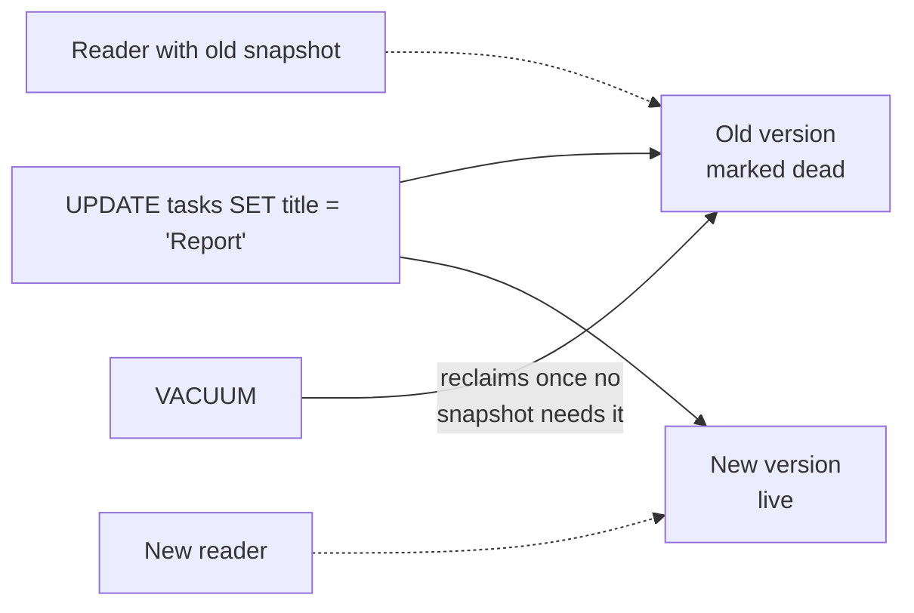

# MVCC and VACUUM (PostgreSQL)

> PostgreSQL never overwrites a row in place. It writes a **new version** and lets each
> transaction see the versions that were committed when its snapshot was taken.

[← Handbook](../README.md) · [All concepts](README.md)

---

## How it works

- Every row version carries the transaction id that created it (`xmin`) and, once replaced or
  deleted, the one that ended it (`xmax`).
- An `UPDATE` = mark the old version dead + insert a new version. A `DELETE` = mark it dead.
- Each transaction (or statement, under Read Committed) gets a **snapshot**: it sees only versions
  committed before the snapshot.

Result: **readers never block writers, and writers never block readers.** That's why Postgres
handles mixed read/write traffic well.

## Picture it



## The cost: dead tuples

Old versions stay on disk until nothing can see them any more. Those are **dead tuples**. Left
alone they cause **bloat**: bigger tables and indexes, more I/O, slower scans.

**VACUUM** reclaims dead tuples so space can be reused. **Autovacuum** runs it automatically based
on how many rows changed. VACUUM also **freezes** old transaction ids to prevent transaction-id
wraparound.

## The long-transaction trap

VACUUM can only remove versions that **no running transaction could still need**. One transaction
left open for hours — including a session stuck `idle in transaction` — pins its snapshot, so dead
tuples created since then can't be cleaned **anywhere it might read**. Hot tables bloat while it
sits there.

```sql
-- Who's holding old snapshots?
SELECT pid, state, now() - xact_start AS xact_age, left(query, 60)
FROM pg_stat_activity
WHERE xact_start IS NOT NULL
ORDER BY xact_start
LIMIT 10;

-- How much dead weight per table?
SELECT relname, n_live_tup, n_dead_tup, last_autovacuum
FROM pg_stat_user_tables
ORDER BY n_dead_tup DESC
LIMIT 10;
```

## Operating it well

- Keep transactions **short**. Never hold one open across HTTP calls or user think-time.
- Set `idle_in_transaction_session_timeout` and `statement_timeout`.
- Alert on the age of the oldest transaction.
- Tune autovacuum per table for very hot tables (e.g. lower `autovacuum_vacuum_scale_factor`).
- Page through large reports in short transactions ([keyset pagination](keyset-pagination.md)),
  not one six-hour transaction.

## Pitfalls

- A forgotten `BEGIN` in a script or a client that never commits.
- Turning autovacuum off "for performance".
- Frequent updates to one huge row (e.g. a counter in a wide row) creating heavy churn.

## Related

[Isolation levels and write skew](isolation-levels-and-write-skew.md) ·
[Connection pooling](connection-pooling.md) · [EXPLAIN ANALYZE](../sql/explain-analyze.md)

## Further reading

- PostgreSQL docs, *Concurrency Control*: https://www.postgresql.org/docs/current/mvcc.html
- PostgreSQL docs, *Routine Vacuuming*: https://www.postgresql.org/docs/current/routine-vacuuming.html
