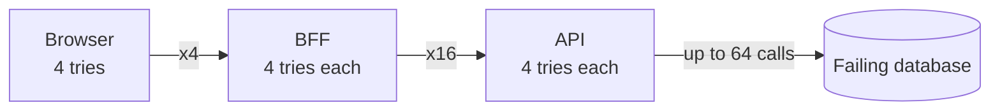

# Retries, exponential backoff and jitter

> Retry failed calls **only when safe**, wait **longer each time**, add **randomness**, and cap the
> total so retries can't overwhelm a struggling dependency.

[← Handbook](../README.md) · [All concepts](README.md)

---

## When to retry

| Retry | Don't retry |
|---|---|
| Timeouts, connection resets | `400`, `401`, `403`, `404`, `422` — the request is wrong |
| `429 Too Many Requests` (honour `Retry-After`) | Non-idempotent operations without an [idempotency key](idempotency.md) |
| `502`, `503`, `504` | When the caller's deadline has already passed |
| Serialization failures (`40001`), deadlocks (`40P01`) | |

## Exponential backoff with jitter

```ts
async function retry<T>(fn: () => Promise<T>, { attempts = 4, baseMs = 100, capMs = 2000 } = {}) {
  for (let attempt = 1; ; attempt++) {
    try {
      return await fn()
    } catch (err) {
      if (!isRetryable(err) || attempt === attempts) throw err
      const backoff = Math.min(capMs, baseMs * 2 ** (attempt - 1))
      await sleep(Math.random() * backoff)          // "full jitter"
    }
  }
}
```

- **Exponential** spacing gives the dependency time to recover.
- **Jitter** spreads clients out. Without it, thousands of clients that failed together retry
  together — a synchronized wave that knocks the service over again.
- **Cap** the delay and the number of attempts.

## Retry budgets

Even well-behaved retries multiply load during an outage. A **retry budget** limits retries to a
fraction of normal traffic (for example, retries ≤ 10% of requests over the last minute). When the
budget is spent, fail fast instead of retrying.

## Retry amplification across layers

If the browser, the BFF and the backend each retry 3 times, one failing database call can turn
into **4 × 4 × 4 = 64** attempts. Retry at **one** layer — usually the one closest to the failure
that knows whether the operation is safe — and propagate deadlines so lower layers stop when the
caller has given up.

## Picture it: retry amplification



Retry at one layer, with backoff, jitter and a budget.

## Pitfalls

- Immediate, unlimited retries.
- Retrying a `POST` that charged a card.
- Retrying inside a database transaction that holds locks.
- No timeout on each attempt — a retry loop around a call that hangs forever never retries.

## Related

[Idempotency](idempotency.md) · [Circuit breakers, bulkheads and load shedding](circuit-breakers-bulkheads-load-shedding.md) ·
[Little's Law](littles-law.md)

## Further reading

- AWS Builders' Library, *Timeouts, retries, and backoff with jitter*:
  https://aws.amazon.com/builders-library/timeouts-retries-and-backoff-with-jitter/
