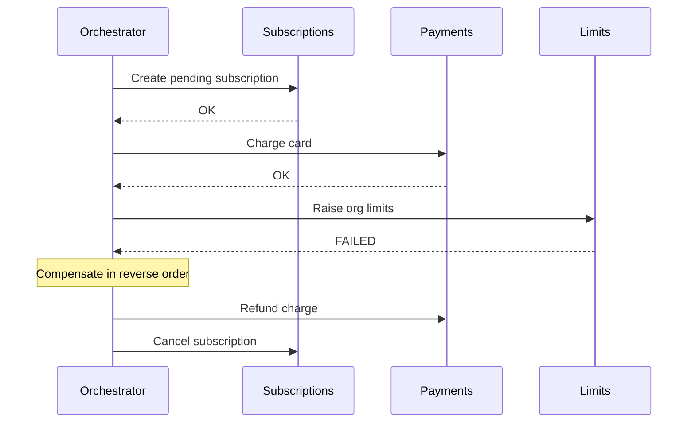

# Sagas

> A long-running business process split into **local transactions**, each with a
> **compensating action** that undoes it if a later step fails.

[← Handbook](../README.md) · [All concepts](README.md)

---

## Why

When a process spans several services or external systems, you can't wrap it in one database
transaction. Two-phase commit across services is fragile and rarely available. A saga accepts
temporary inconsistency and guarantees the process ends in a consistent state — either all steps
complete, or completed steps are compensated.

## Example: upgrading a TaskFlow org to a paid plan

| Step | Action | Compensation |
|---|---|---|
| 1 | Create a pending subscription | Cancel the subscription |
| 2 | Charge the card (payment provider) | Refund the charge |
| 3 | Raise the org's limits | Restore the old limits |
| 4 | Send the receipt email | (none needed — or send a correction) |

If step 3 fails, run compensations for 2 and 1, in reverse order.

## Picture it: orchestration with compensation

## Two styles

**Choreography** — each service reacts to events from the previous one.
- ✅ Loose coupling, no central component.
- ❌ The flow is implicit and spread across services; hard to see, debug and change.

**Orchestration** — a coordinator tells each participant what to do and tracks state.
- ✅ The flow is explicit, observable, versionable; easy to add timeouts and retries.
- ❌ One more component to run.

For business-critical flows, **orchestration** is usually the better choice.

| Tool | Cloud |
|---|---|
| Workflows | Google Cloud |
| Step Functions | AWS |
| Temporal, Restate | Any (self-hosted or managed) |

## Design rules

- Every step and every compensation must be **[idempotent](idempotency.md)** — they will be retried.
- Compensations are business actions (refund), not technical rollbacks; they can fail too, so
  retry them and alert if they keep failing.
- Persist saga state so a crashed coordinator can resume.
- Put the irreversible step (sending email, shipping goods) as late as possible.
- Make intermediate states visible to users ("upgrade in progress").

## Related

[Outbox pattern](outbox-pattern.md) · [Idempotency](idempotency.md) ·
[Retries, backoff and jitter](retries-backoff-jitter.md)

## Further reading

- microservices.io, *Saga*: https://microservices.io/patterns/data/saga.html
- Garcia-Molina & Salem, *Sagas* (1987) — the original paper
