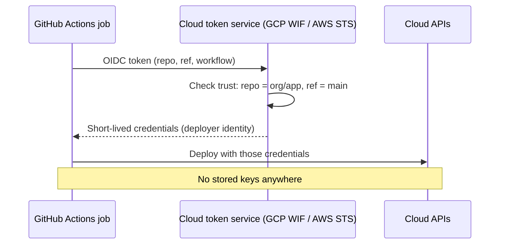

# Workload identity and keyless CI/CD

> Let workloads and pipelines prove **who they are** to the cloud with short-lived tokens, instead
> of storing long-lived keys.

[← Handbook](../README.md) · [All concepts](README.md)

---

## The problem with keys

A service account key file or an AWS access key pair is a **long-lived password for software**.
Keys get committed to repositories, copied to laptops, pasted into CI secrets and forgotten. If one
leaks, it works until someone notices and revokes it.

## Workloads running in the cloud

The platform gives the workload an identity and hands it short-lived credentials automatically.

| | Google Cloud | AWS |
|---|---|---|
| Identity | A **service account** attached to the Cloud Run service, VM or GKE workload | An **IAM role**: EC2 instance profile, ECS task role, Lambda execution role, EKS Pod Identity / IRSA |
| How code gets credentials | Client libraries read them from the metadata server | SDKs read them from the instance/task metadata endpoint |
| What you store | Nothing | Nothing |

## CI/CD outside the cloud: OIDC federation

CI systems such as GitHub Actions can issue an **OIDC token** describing the job: repository,
branch, workflow, environment. The cloud verifies that token and exchanges it for short-lived
cloud credentials.



**Google Cloud — Workload Identity Federation**
```yaml
permissions: { id-token: write, contents: read }
steps:
  - uses: google-github-actions/auth@v2
    with:
      workload_identity_provider: projects/123/locations/global/workloadIdentityPools/github/providers/my-repo
      service_account: deployer@my-project.iam.gserviceaccount.com
```

**AWS — IAM OIDC provider**
```yaml
permissions: { id-token: write, contents: read }
steps:
  - uses: aws-actions/configure-aws-credentials@v4
    with:
      role-to-assume: arn:aws:iam::123456789012:role/github-deployer
      aws-region: us-east-1
```

## Scope the trust tightly

The trust policy decides **which** jobs may assume the identity. Always restrict by:
- the exact **repository** (`repository` / `sub` claim);
- the **branch or environment** allowed to deploy (`ref` / `environment`);
- optionally the workflow file.

A trust that accepts "any repository in the org" — or worse, any GitHub token — lets an unrelated
repo deploy to production.

## Related

[Least privilege](least-privilege-iam.md) · [JWTs and token verification](jwt-and-token-verification.md)

## Further reading

- Google Cloud, *Workload Identity Federation*: https://cloud.google.com/iam/docs/workload-identity-federation
- AWS, *Create an OpenID Connect (OIDC) identity provider in IAM*: https://docs.aws.amazon.com/IAM/latest/UserGuide/id_roles_providers_create_oidc.html
- GitHub, *About security hardening with OpenID Connect*: https://docs.github.com/en/actions/security-for-github-actions/security-hardening-your-deployments/about-security-hardening-with-openid-connect
