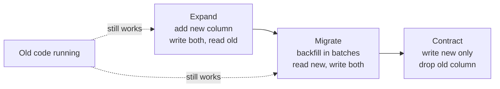

# Zero-downtime migrations (expand → migrate → contract)

> Change a live database schema in **backward-compatible steps**, so old and new code both keep
> working throughout a deploy.

[← Handbook](../README.md) · [All concepts](README.md)

---

## Why one-step changes break things

During a rolling deploy, old and new versions of your app run **at the same time** against the
same database. Migrations usually run before the new code starts. So:
- Renaming `title` → `name` in one migration breaks the old code still reading `title`.
- Dropping a column the old code still writes breaks inserts.
- A long `ALTER TABLE` lock stalls every request.

## The three phases

**1. Expand** — add the new thing without removing anything.
- Add the new column **nullable** (or with a constant default).
- Create new indexes `CONCURRENTLY`.
- Deploy code that **writes both** old and new, and still reads old.

**2. Migrate** — move data and switch reads.
- **Backfill** existing rows in batches.
- Verify the new column is complete and correct.
- Deploy code that **reads new** (still writes both).

**3. Contract** — remove the old thing, in a **later** release.
- Deploy code that stops writing the old column.
- Then a migration drops it.

## Picture it



## Example: rename `tasks.title` to `tasks.name`

```sql
-- Release 1 (expand)
ALTER TABLE tasks ADD COLUMN name text;
-- app writes title AND name; reads title

-- Backfill in batches (repeat until 0 rows)
UPDATE tasks SET name = title
WHERE id IN (SELECT id FROM tasks WHERE name IS NULL AND title IS NOT NULL LIMIT 5000);

-- Release 2: app reads name, writes both
-- Release 3: app writes only name
-- Release 4 (contract)
ALTER TABLE tasks DROP COLUMN title;
```

## Safe recipes

| Change | Safe approach |
|---|---|
| Add column | Nullable, or with a **constant** default (fast in Postgres 11+) |
| Add `NOT NULL` | `ADD CONSTRAINT … CHECK (col IS NOT NULL) NOT VALID` → `VALIDATE CONSTRAINT` → `SET NOT NULL` → drop the check |
| Add foreign key | `ADD CONSTRAINT … FOREIGN KEY … NOT VALID` → `VALIDATE CONSTRAINT` |
| Add index | `CREATE INDEX CONCURRENTLY` (outside a transaction) |
| Rename/drop column | Expand → migrate → contract across releases |
| Change column type | New column + backfill + switch, not `ALTER TYPE` on a big table |

## Always set a lock timeout

```sql
SET lock_timeout = '3s';
SET statement_timeout = '15min';
ALTER TABLE tasks ADD COLUMN name text;
```

Without `lock_timeout`, a DDL statement waiting behind a long query **blocks every later query on
that table** while it waits — your whole app stalls. With it, the migration fails fast and you
retry.

## Rules

- Never edit a migration that has already run in a shared environment — write a new one.
- Backfills are batched, idempotent and resumable.
- Migrations run from CI as part of the deploy, not from laptops.
- Test every migration against a production-sized copy when tables are large.

## Related

[MVCC and VACUUM](mvcc-and-vacuum.md) · [Indexing](indexing.md) ·
[Locking and SKIP LOCKED](../sql/locking-and-skip-locked.md)

## Further reading

- PostgreSQL docs, `ALTER TABLE`: https://www.postgresql.org/docs/current/sql-altertable.html
